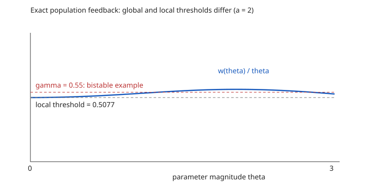

# Theoretical research proposals and sprint 0

**Research-direction update, 15 October:** these proposals are historical. The subsequent fusion and verifier studies failed their baseline gates. See the [policy-capacity study](../../studies/policy_capacity_feedback/research_report.md) for the current theoretical candidate, proofs, and finite-model evidence.

**Prepared:** 14 October 2026. **Basis:** [26-paper analysis](01_expanded_literature_analysis.md), [review/rebuttal audit](03_openreview_discussion_audit.md), and focused primary-literature screens recorded in the evidence notes. **Executed:** deterministic finite-action mathematical checks. **Not executed:** LLM training, human annotation, stochastic scaling experiments, or the open theorem programs below.

## 1. Recommendation and evidence status

Choose **one** main problem. Combining all three would make the assumptions and contribution difficult to defend.

| Priority | Research question | What is already derived here | What a full theoretical paper still needs | Main risk |
|---|---|---|---|---|
| A: start first | When does solving each fresh preference batch more accurately destabilize online alignment? | Exact scalar global phase diagram, harmful bistability, inner-depth threshold, model-specific correction; elementary finite-batch upper bound below. | Sharp stochastic escape/basin theorem, a target-consistent generalization beyond the scalar example, and realistic controlled evidence. | Performative dynamics and online DPO misspecification are already studied. |
| B: strongest information-theory route | What cardinal calibration is necessary to identify a deployment policy under an unknown choice link? | Binary indistinguishability beyond scale, graph-rank identification, regret floor, calibrated graph upper bound. | Matching budget/noise minimax bounds, admissible adaptive calibration, honest robust deployment. | Cardinal measurements may not be feasible or scientifically meaningful in the intended human task. |
| C: highest potential, highest scope risk | What reward information must be retained beyond component checkpoints to control mixed preferences? | Exact endpoint-only impossibility, local residual-response criterion, algebraic rank lower bound. | Fixed-summary strengthening, feasible noisy comparison recovery, uniform control-family guarantee and compression advantage. | Gradient/Hessian merging and full reward retention may already solve the practically relevant case. |

**Status labels:** “derived” means the stated finite model has an argument in this report, supported where relevant by independent checks; it does not mean a published or externally peer-reviewed theorem. “Standard” means an existing identity/tool, not our novelty. “Open target” means a proposition requiring research. “Expected” means a falsifiable qualitative prediction, not a measured result. No acceptance probability is assigned. ICML/NeurIPS/ICLR suitability depends on completing a substantive theorem package and its evidence; ACL/EMNLP suitability additionally needs a convincing language-specific question and evaluation.

The numerical verification code and exact outputs are [here](verification/analytic_checks.py) and [here](verification/analytic_checks_results.json). It uses only Python 3's standard library. Source-code implementations of the inspected papers were not reproduced.

## 2. Proposal A — Optimization depth and harmful feedback in misspecified online DPO

### 2.1 Precise question and mechanism

Fresh sampling improves coverage under realizability. Under misspecification, a changing comparison distribution also changes which incompatible reward residual the likelihood tries to fit. An exact inner fit can move the policy across the correct target, then the next distribution induces a correction in the opposite direction. A shallow update can behave differently because it refreshes data before fully following that pseudo-true target.

The potential contribution is a **sharp preference-specific dynamic and statistical characterization of over-solving**, with true restricted reward regret. Generic oscillation, damping or mixing is already prior work.

### 2.2 Model contract

One prompt, three actions, features $f=(-1,0,1)$, uniform reference, scalar policy

$$
\pi_\theta(i)=\frac{e^{\theta f_i}}{1+2\cosh\theta},\qquad \theta\in[-R,R].
$$

True reward is $r=(0,a,0)$ with $a>0$. Pair labels obey exact BT: $P(Y=1\mid i,j)=\sigma(r_i-r_j)$. Both actions are sampled independently from the deployed $\pi_\theta$. The learner's logit is $\gamma u(f_i-f_j)$, always against the **fixed initial reference**, with $\gamma>0$. The full population batch loss is

$$
L_\theta(u)=\sum_{i,j}\pi_\theta(i)\pi_\theta(j)
\left[-p_{ij}\log\sigma(\gamma u(f_i-f_j))
-(1-p_{ij})\log(1-\sigma(\gamma u(f_i-f_j)))\right].
$$

The deployed next policy is $T(\theta)=\arg\min_{u\in[-R,R]}L_\theta(u)$. This is repeated frozen-distribution risk minimization, not a gradient through the sampling distribution and not moving-reference reward tilting. All policies have full action support; labels remain correct; reward is not realizable because its middle-action advantage cannot be expressed as an affine function of $f$.

The actual restricted objective is

$$
J_\gamma(\theta)=a\pi_\theta(2)-\gamma\mathrm{KL}(\pi_\theta\|\pi_0).
$$

Its unique maximizer is $\theta=0$: middle-action mass strictly decreases with $|\theta|$, while KL strictly increases, since $\partial_\theta\mathrm{KL}=\theta\operatorname{Var}_{\pi_\theta}(f)$.

### 2.3 Derived result A1 — Exact global dynamics

Let $b=\tanh(a/2)$. Direct summation of the ordered pairs gives

$$
\partial_u L_\theta(u)=\frac{2\gamma}{(1+2\cosh\theta)^2}
\left[\cosh\theta\tanh(\gamma u/2)+\tanh(\gamma u)+b\sinh\theta\right].
$$

The independent pair-sum implementation agrees with this expression to maximum absolute error $5.56\times10^{-17}$ on the verification grid. For $\theta>0$, define the unique positive root $w(\theta)$ by

$$
\cosh\theta\tanh(w/2)+\tanh w=b\sinh\theta.
$$

Then $T(\theta)=-\min\{R,w(\theta)/\gamma\}$, with an odd extension. Strict monotonicity of the left side establishes uniqueness; $0<w<a$. Implicit differentiation gives

$$
w'(\theta)=\frac{b\operatorname{sech}\theta+\tanh\theta\tanh w}
{\tfrac12\cosh\theta\operatorname{sech}^2(w/2)+\operatorname{sech}^2w}>0.
$$

Thus the magnitude update $U(t)=\min\{R,w(t)/\gamma\}$ is continuous and increasing. If $U(t_0)\ge t_0$, successive magnitudes increase; otherwise they decrease. They are bounded and converge to a fixed magnitude. Every signed orbit therefore converges to zero or a symmetric two-cycle. This all-orbit classification is specific to this scalar map; it says nothing about higher-dimensional chaos.

Define

$$
\gamma_{\mathrm{loc}}=\frac{2b}{3},\qquad
\gamma_{\mathrm{glob}}(a,R)=\sup_{0<t\le R}\frac{w(t)}{t}.
$$

The expansion

$$
w(t)=\frac{2b}{3}t+\frac{2b^3}{27}t^3+O(t^5)
$$

implies $\gamma_{\mathrm{glob}}>\gamma_{\mathrm{loc}}$ for every $a,R>0$. Also $\gamma_{\mathrm{glob}}\le b$, using concavity of tanh to show $w(t)<bt$. If $\gamma>\gamma_{\mathrm{glob}}$, the magnitude contracts geometrically with factor at most $\rho=\gamma_{\mathrm{glob}}/\gamma<1$. If $\gamma<\gamma_{\mathrm{glob}}$, continuity of $U(t)-t$ yields a nonzero fixed magnitude and hence a harmful cycle. Equality cases require separate analysis.

**Consequence:** checking the Jacobian at the correct fixed point cannot certify global stability. A stable correct point and a harmful attracting cycle can coexist.

| Independently checked example: $a=2,\gamma=0.55,R=3$ | Magnitude | One-step derivative magnitude | Two-step multiplier | True regularized regret |
|---|---:|---:|---:|---:|
| Correct fixed point | 0 | 0.923144 | 0.852195 approximately | 0 |
| Repelling cycle | 1.261849168 | 1.113585 | 1.240072 | 0.459343 |
| Attracting cycle | 2.770367077 | 0.717375 | 0.514626 | 1.017304 |

The grid estimate of the global threshold is a **lower bound from a finite grid**, 0.572634, not a certified exact maximum. The local threshold is 0.507729. These numbers describe a constructed finite-action problem, not LLM improvements.

### 2.4 Derived result A2 — A sharp local inner-depth threshold

Freeze the distribution induced by $\theta$, initialize $u_0=\theta$, and take $q$ fitting steps:

$$
u_{j+1}=u_j-\eta\partial_uL_\theta(u_j),\qquad T_q(\theta)=u_q.
$$

At zero, $H=\gamma^2/3$, $B=2b\gamma/9$ and $c=B/H=2b/(3\gamma)$. When $s=1-\eta H\in(0,1)$, differentiating the recursion gives

$$
T_q'(0)=(1+c)s^q-c.
$$

For $c>1$, local instability begins when

$$
s^q<\frac{c-1}{c+1}.
$$

The derivative moves toward the exact-fit value $-c$ as fitting depth increases. At $a=2,\gamma=0.3,\eta=1$, independent finite differences give derivative 0.919227 at one step, 0.012554 at fifteen, and $-1.105305$ at fifty. The formula matches within $10^{-8}$. This verifies the local threshold, not a global classification of every finite-depth map.

### 2.5 Derived model-specific corrections

**One step per refresh.** The diagonal gradient $g(\theta)=\partial_uL_\theta(\theta)$ has the sign of $\theta$. On a compact interval, its continuous ratio $g(\theta)/\theta$ has positive minimum and finite maximum. A sufficiently small fixed step gives global geometric inward movement and improves $J_\gamma$ each population iteration. The conservative bound $\eta\le1/(\gamma^2+8\gamma)$ follows from bounded features and labels; it is loose. Empirical SGD does not inherit a pathwise guarantee.

**Pair-source anchoring.** Alternatively sample a complete pair from the current policy with probability $\alpha$, otherwise from the uniform reference:

$$
q_{\theta,\alpha}=\alpha\pi_\theta^{\otimes2}+(1-\alpha)\pi_0^{\otimes2}.
$$

This differs from independently sampling each action from a mixture policy. Set

$$
D_t=\frac{b\sinh t-\cosh t\tanh(\gamma t/2)-\tanh(\gamma t)}{(1+2\cosh t)^2},\qquad
E_t=\frac{\tanh(\gamma t/2)+\tanh(\gamma t)}9.
$$

The exact pointwise inward condition is $\alpha D_t-(1-\alpha)E_t<0$. A sharp sufficient strict-inward threshold is

$$
\alpha_{\mathrm{crit}}=\inf_{\substack{0<t\le R\\D_t>0}}\frac{E_t}{E_t+D_t},
$$

with value one if the index set is empty; the limiting local condition is $\alpha\,2b/(3\gamma)<1$. Strictly satisfying both yields uniform geometric contraction. In this symmetric example the correct restricted target remains zero. In a general misspecified family anchoring can change the projection target; stability alone does not guarantee reward optimality.

### 2.6 Derived auxiliary finite-batch bound — useful, but standard

Here is a complete conservative statistical ingredient for the stable exact-refit regime. Assume $\gamma>\gamma_{\mathrm{glob}}$, conditional IID batches of $n$ action pairs/BT labels, and exact constrained empirical fitting over $[-R,R]$ for $K$ rounds.

Since $\pi_\theta(i)\ge p_{\min}=e^{-2R}/3$, population curvature throughout the fitting interval is at least

$$
\underline H=4\gamma^2p_{\min}^2\sigma(\gamma R)(1-\sigma(\gamma R))>0.
$$

This bound keeps only the four ordered middle-to-endpoint pairs. Each sample gradient is in $[-2\gamma,2\gamma]$ and is $\gamma^2$-Lipschitz in $u$. For an $h$-net of size $M$ covering the fitting interval, conditional Hoeffding concentration, a union bound over net points and rounds, and Lipschitz extension give, with probability at least $1-\delta$,

$$
\sup_u|\widehat L'_k(u)-L'_k(u)|\le
\epsilon_g=\gamma\sqrt{\frac{8\log(2MK/\delta)}n}+\gamma^2h
$$

for every round. Strong monotonicity and the constrained optimality inequalities imply $|\widehat T_k(\theta_k)-T(\theta_k)|\le\epsilon_g/\underline H$, including boundary optima. Therefore

$$
|\theta_k|\le\rho^k|\theta_0|+\frac{\epsilon_g}{\underline H(1-\rho)}.
$$

The particular true objective also satisfies

$$
J_\gamma(0)-J_\gamma(\theta)\le
\left(\frac{a\cosh R}{9}+\frac\gamma2\right)\theta^2,
$$

using $\cosh\theta-1\le\theta^2\cosh R/2$ and $\operatorname{Var}(f)\le1$. This yields an explicit high-probability regret floor of order $\log(nK/\delta)/n$ for fixed strictly stable parameters after choosing a sufficiently fine net.

**Limit:** the constants deteriorate strongly with $R$ and proximity to the stability boundary. This elementary contraction/M-estimation argument is not a new minimax theorem, does not prove stochastic escape below the threshold and does not justify a neural guarantee. It is a valid benchmark against which a sharper result should improve.

### 2.7 Open theorem package required for a paper

1. **Escape below the local boundary:** prove logarithmic-in-batch-size exit time from a neighborhood of zero under genuine conditional Bernoulli noise. Specify starting distribution, exit radius, compact projection and nondegenerate label noise. Linear instability alone is not the theorem.
2. **Critical regime:** establish or refute the proposed $n^{-1/4}$ parameter scale and $n^{1/2}$ time scale at the cubic boundary. Those exponents are a conjecture from drift/noise balance, not a proved diffusion limit.
3. **Bistable region:** quantify basin crossing and occupation near the harmful cycle, with optimizer tolerance and finite depth separated from label noise. Arbitrary injected Gaussian noise would not validate the BT batch theorem.
4. **Confidence-aware control:** estimate the relevant phase quantities, choose depth or anchored-pair fraction with finite-sample confidence, and prove target regret. A local multiplier estimator cannot certify the global basin.
5. **Beyond scalar symmetry:** identify conditions under which a correction remains consistent with the true restricted reward optimum; supply an impossibility or residual term when it cannot. Extending only the notation to matrices is insufficient.

**Go/no-go:** finish at least one sharp stochastic theorem and one meaningful target-aware extension before treating this as a full theory paper. The exact toy phase diagram is a proof pilot.

### 2.8 Closest literature and novelty collision

[Performative Prediction, ICML 2020](https://proceedings.mlr.press/v119/perdomo20a/perdomo20a.pdf) already establishes risk-refitting cycles and sensitivity/curvature convergence. [Stochastic performative learning, NeurIPS 2020](https://papers.nips.cc/paper/2020/file/33e75ff09dd601bbe69f351039152189-Paper.pdf) already separates greedy and lazy deployment. [DPO/RLHF performance gap](https://arxiv.org/html/2505.19770v1) explicitly studies misspecified log-linear families and online divergence. [Online DPO samplers](https://arxiv.org/html/2409.19605v3) already studies sampler mixtures. [Minimal-deployment stabilization](https://arxiv.org/html/2609.14065v1) supplies a stronger general stability approach. [REBEL](https://arxiv.org/html/2404.16767v2) is an important moving-reference reward-regression baseline. These are substantive collisions, not peripheral citations.

The narrower candidate distinction is the exact global BT phase/basin/depth structure and its sharp stochastic policy-regret consequences. Do not claim first recognition of online DPO failure, first sampler mixing, or first stabilization. The primary technical screen is summarized in the sources above.

### 2.9 Experiments, expectations and ablations

**Synthetic first:** sweep $a$, $\gamma$, $R$, initialization and inner depth; exact population fitting versus IID empirical fitting; include a realizable linear reward control. For stochastic sweeps use at least 100 independent seeds per near-critical condition, prespecified exit radii and sufficient horizons, with confidence intervals and right-censoring reported. Double batch sizes to test scaling. Compare exact fitting, one-step refresh, bounded-depth fitting, pair-source anchoring, action-mixture sampling, AuxDPO and accurate reward-policy optimization. Keep total labels and total gradient work visible separately.

**Primary outcomes:** true restricted regularized regret, distance to target/cycle, basin membership, phase-boundary estimation error, first-exit times, label cost and optimization cost. Pair accuracy and held-out DPO loss are secondary: a good fitting metric may coexist with bad policy reward.

**LLM bridge:** small instruction backbone with restricted adapters on ordinary helpfulness/conciseness data, a fixed reference and independently held-out evaluation. Repeatedly generate/label fresh batches, sweep optimization epochs with equal total compute and equal-label controls, and retain separate full-capacity versus adapter-capacity conditions. At least three independent training seeds for a pilot, five for surviving main claims. Assess capability, length and benign refusal alongside preference scores. A finite pool with known rewards provides the cleanest mechanistic bridge before expensive free-generation tests.

**Expected:** exact fits should cycle in the constructed regime; shallow refresh should stabilize it; realizable controls should remove the misspecification mechanism; increasing batch size should reduce stable-regime error, but should not remove a population cycle. More epochs need not hurt every neural model or every dataset.

**Ablations:** fixed versus moving reference; fixed versus refreshed distribution; matched total steps versus matched epochs; pair-source versus action mixture; real Bernoulli noise versus optimizer error; symmetric versus asymmetric reward; adapter rank; reference entropy; clipped versus exact minimizer; independent versus correlated judge errors. Include a conservative optimizer baseline so a learning-rate reduction is not mistaken for a new algorithm.

**Kill criteria:** existing work already proves the same sharp result; stochastic results reduce to a direct generic theorem without new structure; cycles disappear under realistic finite-depth/capacity controls; correction stabilizes the wrong reward projection; or equivalent tuning of established baselines explains all observed benefit.

## 3. Proposal B — Cardinal policy identification with unknown preference links

### 3.1 Question and model contract

For a fixed pool of $m$ candidates, comparisons obey

$$
P(Z_{ij}=1)=F(u_i-u_j),\qquad F(-t)=1-F(t),
$$

where $F$ is unknown and strictly increasing. The intended policy uses known cardinal tradeoff $\tau>0$:

$$
\pi_u(i)=\frac{\pi_0(i)e^{u_i/\tau}}{\sum_j\pi_0(j)e^{u_j/\tau}},\qquad \pi_0(i)>0.
$$

The target is declared cardinal utility $u$, not simply winner prediction. Available additional calibrated contrasts are $G_e=(Au)_e+\varepsilon_e$, in known utility units. An ordinary uncalibrated Likert score is not this measurement. Establishing meaningful units is part of the problem, not an incidental implementation choice.

### 3.2 Derived result B1 — Ambiguity beyond an unknown global scale

Take $u=(0,1,3)$ and $v=(0,1,4)$, and let $F=\sigma$. Construct symmetric increasing $F'$ mapping positive gaps $1,3,4$ to $\sigma(1),\sigma(2),\sigma(3)$ respectively. Monotone interpolation supplies such a link. All edge probabilities agree between $(u,F)$ and $(v,F')$, including the calibrated first gap of one. The two utility vectors are not related by a common affine scaling that preserves that anchor, but $\pi_u\ne\pi_v$.

Therefore even infinite binary observations of every edge and one exact gap anchor may fail to identify the deployment policy. This is a finite-pool unknown-link result. It does not invalidate known-scale BT identification, richer feature support with structural links, or existing ternary heterogeneity theorems.

**Why MixDPO matters:** $F(t)=\mathbb E\sigma(Bt)$ represents uncertainty in preference strength. With moments $m_j=\mathbb E B^j$, its aggregate logit satisfies

$$
\operatorname{logit}F(t)=m_1t+\frac{m_1^3-m_3}{12}t^3+O(t^5).
$$

Thus $\operatorname{logit}F(2t)-2\operatorname{logit}F(t)$ can be nonzero although all annotators share the same winner direction. Ordinary scalar BT reward fitting can be misspecified even without preference cycles. The $(u,F)$ indistinguishability theorem concerns a broader monotone-link class; it must not be automatically asserted within a narrowly parameterized MixDPO family.

### 3.3 Derived result B2 — Nonvanishing policy-regret floor

Standard Gibbs optimality gives

$$
J_\tau(\pi_u;u)-J_\tau(\pi;u)=\tau\mathrm{KL}(\pi\|\pi_u).
$$

For two observationally indistinguishable utilities, every estimator has worst-world expected regret at least

$$
-\tau\log\sum_i\sqrt{\pi_u(i)\pi_v(i)}.
$$

Proof: worst loss is at least the average of the two reverse-KL losses. Minimizing that average gives their normalized geometric mean and the displayed value. Convexity extends the lower bound to randomized estimators. This is a lower bound, not a claim that it always equals the minimax maximum-loss value.

With uniform reference and $\tau=1$, the policies are $(0.042010,0.114195,0.843795)$ and $(0.017148,0.046613,0.936240)$; the checked lower bound is 0.011450857. Its numerical magnitude is illustrative.

### 3.4 Derived result B3 — Generic anchor-rank identification

For noiseless calibrated edge contrasts, a connected anchor graph has $\operatorname{rank}A=m-1$ and determines $u$ up to an additive constant, which leaves $\pi_u$ unchanged.

Conversely, let $A$ have a nonconstant null direction and let all absolute utility gaps be nonzero and distinct. A sufficiently small perturbation along this direction preserves anchors and the strict ordering of every positive gap. A new symmetric increasing link interpolates unchanged binary probabilities on the perturbed gaps. Hence the policy remains locally nonidentified. Full contrast rank is necessary for generic worst-case recovery in this unrestricted finite-pool link class. Nongeneric repeated gaps and extra link restrictions require separate treatment.

A spanning tree supplies a minimal count of **distinct exact contrast directions**. It does not imply that $m-1$ noisy ratings achieve accurate policy estimation.

### 3.5 Standard constructive benchmark and derived regret bound

For independent Gaussian calibrated errors, counts $k_e$ and variances $s_e^2$, graph least squares on the mean-zero subspace has

$$
I=A^\top\operatorname{diag}(k_e/s_e^2)A,
\qquad \operatorname{Cov}(\widehat u-u)=I^+.
$$

If $e=\widehat u-u$, the policy plug-in regret obeys

$$
J_\tau(\pi_u;u)-J_\tau(\pi_{\widehat u};u)
\le\frac{(\max_i e_i-\min_i e_i)^2}{8\tau}.
$$

To see this, write the loss as a log-partition Bregman divergence along the segment between $u$ and $\widehat u$. Its directional second derivative is $\operatorname{Var}_{\pi}(e)/\tau\le\operatorname{range}(e)^2/(4\tau)$; the integral remainder contributes one half.

For coordinate vectors $b_i$, define $V_{\max}=\max_{i,j}(b_i-b_j)^\top I^+(b_i-b_j)$. Gaussian tails and a union bound yield, with probability $1-\delta$,

$$
\operatorname{Regret}\le\frac{V_{\max}}{4\tau}\log\frac{m(m-1)}\delta.
$$

The local expected leading term is

$$
\frac1{2\tau}\operatorname{tr}\!\left[(\operatorname{diag}(\pi_u)-\pi_u\pi_u^\top)I^+\right].
$$

These are ordinary graph estimation and policy-risk tools. The contribution cannot be that trace expression or generic optimal-design acquisition. Connectivity ensures identification; effective resistance and noise determine finite-budget precision.

### 3.6 Proposed algorithm and open theorem package

**Algorithm to study:** maintain an identified/confidence set of utilities and links; acquire calibrated contrasts when binary feedback cannot shrink policy uncertainty; allocate noisy contrasts according to target-relevant uncertainty; deploy the policy minimizing worst-case regularized regret over the remaining set. Profile/isotonic link fitting supplies a baseline, not an automatic confidence theorem.

1. Prove a minimax decomposition of regret into residual identified-set ambiguity and finite-anchor estimation cost, with matching lower/upper dependence on utility range, temperature and graph geometry.
2. Establish when binary observations are locally uninformative about cardinal utility after nuisance-link profiling, and which restricted link classes restore information. Infinite pair data should not be claimed universally useless.
3. Prove a feasible robust-deployment guarantee with confidence sets valid under an estimated link and finite calibration noise. Exact graph least squares addresses only the fully calibrated benchmark.
4. Adapt to uncertain contrast reliability without RDPO's oracle population-error ratio. Model dependence when rankings are derived from the same scores; do not multiply them as independent evidence.
5. Study low-dimensional utility features or selective decision objectives if full graph rank is too costly. The assumption reducing the budget must be explicit and empirically tested.

**Critical feasibility question:** can the application produce meaningful independently calibrated cardinal gaps? If not, redefine the target as an identified ordinal/choice objective rather than silently imposing arbitrary utility units.

### 3.7 Novelty and closest literature

[RDPO](https://arxiv.org/abs/2602.00603) already uses rating gaps, oracle robustness and partly missing ratings. [Unobserved preference heterogeneity](https://arxiv.org/abs/2510.15716) already establishes binary identification difficulties and a ternary route. [NAOD](https://arxiv.org/abs/2609.38860) already supplies policy-risk information design with finite-dimensional judge bias. These block “add sparse scores,” “latent EM” and generic Fisher-design claims.

The candidate distinction is **unknown nonparametric link, cardinal deployment target, admissible calibration rank/budget and minimax identified-set regret**. This focused audit does not prove exhaustive novelty. Before investing in human data, expand the primary-source screen to semiparametric paired comparison, random-utility identification and graph cardinal measurement. An existing theorem with the same information model would change the project.

### 3.8 Experiments, expectations and ablations

**Synthetic:** vary $m$, utility gaps, saturation, choice-link family and mixture variance, anchor connectivity, noise and total cost. Include indistinguishable worlds, known-link positives, repeated equal-gap exceptions and misspecified rating scales. Run exact population identified sets before noisy fitting; noisy sweeps should use at least 100 seeds per principal condition.

**Baselines:** ordinary DPO, MixDPO, RDPO, ML-RDPO, calibrated graph least squares, known-link oracle, profile/isotonic unknown-link fitting and robust identified-set deployment. Ternary methods must receive their required observations and be evaluated under their own model assumptions. Compare annotation cost, not merely number of rows.

**Real-language pilot:** multiple candidates per prompt, repeated independent judgments and a prespecified calibration protocol. HelpSteer-style ordinal scores alone can test robustness to score distortions, but cannot validate a theorem about ground-truth cardinal utility. Use a task with externally meaningful utility/cost where possible, or explicitly evaluate only choice prediction and identified policy uncertainty.

**Expected:** increasing binary data alone leaves a regret floor in the constructed unknown-link worlds; connected calibrated contrasts remove structural ambiguity; better-connected/noisier graphs change precision according to effective resistance; accurate winner prediction can coexist with large cardinal policy error. Binary information may help under a structurally restricted link.

**Ablations:** anchor rank versus label count; tree versus well-connected graph; known versus estimated link; independent versus score-derived ranking; calibrated versus affine/monotone-distorted ratings; oracle versus learned trust; reference/temperature; point-estimate versus robust deployment; equal budget in contrasts versus extra binary labels.

**Kill criteria:** model contract duplicates an existing calibration theorem; cardinal units cannot be justified; the algorithm assumes oracle gap noise; gains vanish against cost-matched anchor-only estimation; or the proposed minimax theorem reduces entirely to classical graph regression without a new identified-set result.

## 4. Proposal C — The information discarded by component policy optimization

### 4.1 Question and information model

Given exact policies separately optimized for $K$ component rewards, can an algorithm recover all restricted-class optima for mixtures and shifted prompt distributions? Inputs must be specified: checkpoints only, policy Fisher, objective Hessians, finite objective derivatives, full preference data or arbitrary reward access are different problems.

The initial theorem concerns **checkpoint-only** inputs. It is stronger than demonstrating poor parameter averaging: every endpoint-only algorithm sees the same input in two reward worlds. It is weaker than defeating all curvature-retaining or reward-retaining methods.

### 4.2 Derived result C1 — Exact endpoints can hide a different mixed optimum

Use the same scalar policy family $\pi_\theta\propto e^{\theta f}$, $f=(-1,0,1)$, uniform reference and KL coefficient one. For $t>0$, let $p=\pi_t$, $m=\mathbb E_p f$ and

$$
h=\left(1,0,\frac{p_-(1+m)}{p_+(1-m)}\right),\qquad
k(\theta)=\frac{\operatorname{Cov}_{\pi_\theta}(f,h)}{\operatorname{Var}_{\pi_\theta}(f)}.
$$

Construct two worlds:

$$
\mathcal W_0:\quad r_1=tf,\quad r_2=-tf;
\qquad
\mathcal W_\delta:\quad r_1=tf+\delta h,\quad r_2=-tf.
$$

By construction $k(t)=0$. The first component objective derivative is

$$
U_1'(\theta)=\operatorname{Var}_{\pi_\theta}(f)[t-\theta+\delta k(\theta)].
$$

The function $k$ is a weighted average of pair slopes $(h_i-h_j)/(f_i-f_j)$, with weights proportional to $e^{\theta(f_i+f_j)}(f_i-f_j)^2$. Its derivative is a covariance of bounded pair slopes and bounded pair feature sums, hence bounded on the whole line. For sufficiently small $\delta$ such that $\delta\sup|k'|<1$, the bracket is strictly decreasing, crosses zero exactly at $t$, and gives the unique global component optimum. The second optimum is exactly $-t$ in both worlds.

For the equal mixture, $\mathcal W_0$ has optimum zero, whereas $\mathcal W_\delta$ has a unique nearby optimum satisfying

$$
\theta^*_{1/2}=\frac\delta2k(\theta^*_{1/2}).
$$

Since $k(0)\ne0$, the mixed optimum changes. Both algorithms nevertheless receive exactly the same endpoints $(\pi_t,\pi_{-t})$.

At $t=1,\delta=0.2$, $h=(1,0,0.501852057)$. The component optimum is exactly one; the mixed optimum is $-0.025546857$. Its regularized objective improvement over midpoint zero is 0.0002120904. Independent reward evaluation and a dense component grid reproduce these values. Bounded pair-slope covariance also certifies the small-perturbation condition here; this is not merely an approximate numerical endpoint match.

A common local strong-concavity neighborhood yields a worst-world lower bound of order the squared optimizer separation, hence $\Omega(\delta^2)$ for fixed $t$. To formalize a uniform minimax theorem, specify the compact policy domain and a positive objective gap outside the neighborhood so arbitrary far-away outputs cannot evade the argument.

**Why this is different from tangent curvature:** the action family is already log-linear. Missing reward residual information remains even when endpoint optimization is exact. Objective Hessians can differ in this particular example, so it does not establish failure of methods retaining those Hessians.

### 4.3 Derived result C2 — Local residual observability criterion

For component endpoint $\theta_k$ under source prompt law $\mu_S$, let

$$
A_kh_k=\mathbb E_{\mu_S,\pi_{\theta_k}}[s_{\theta_k}(x,a)h_k(x,a)],
\qquad s_\theta=\nabla_\theta\log\pi_\theta.
$$

Stack these operators as $Bh=(A_1h_1,\ldots,A_Kh_K)$. A perturbation in $\ker B$ preserves endpoint first-order conditions. Maintaining positive local curvature and a strict outside-neighborhood gap preserves the global endpoint for a sufficiently small perturbation; local curvature alone does not guarantee this.

At a mixed target optimum, define

$$
C_{\alpha,\mu_T}h=\sum_k\alpha_k
\mathbb E_{\mu_T,\pi_{\theta^*_{\alpha,\mu_T}}}[s_{\theta^*}h_k],
\qquad H_{\alpha,\mu_T}=-\nabla_\theta^2 U_{\alpha,\mu_T}\succ0.
$$

Standard implicit differentiation gives

$$
\left.\frac{d\theta^*(\delta)}{d\delta}\right|_0
=H_{\alpha,\mu_T}^{-1}C_{\alpha,\mu_T}h.
$$

If $h\in\ker B$ but $C_{\alpha,\mu_T}h\ne0$, endpoint data hide a perturbation relevant to the target. Necessary local sufficiency across a family is

$$
\ker B\subseteq\bigcap_{\alpha,\mu_T}\ker C_{\alpha,\mu_T}.
$$

This is necessary, not a global sufficiency theorem. Multiple optima, disconnected branches, large perturbations and conditional preference shift need additional assumptions. Changing prompt law can expose a residual without changing the underlying rewards.

### 4.4 Derived rank facts and their limits

For $q$ distinct scalar action features, if $\operatorname{Cov}_{\pi_\theta}(f,h)=0$ for an open interval of $\theta$, then $h$ is constant. Proof: $\partial_\theta\mathbb E_{\pi_\theta}h=0$ makes that expectation constant; multiplying by the partition function and using linear independence of $e^{\theta f_i}$ makes every $h_i$ equal. One endpoint supplies only one covariance equation, leaving $q-2$ nonconstant residual dimensions. A continuum of desired mixtures can therefore expose much more reward information than the number of named objectives suggests.

For a finite-dimensional residual space, write $K_0=\ker B$ and stack all required target response operators in $C$. If additional measurements $D$ may be arbitrary exact linear functionals, the minimum extra rank is

$$
r_{\min}=\operatorname{rank}(C|_{K_0}).
$$

Necessity follows from rank-nullity and $\ker(D|_{K_0})\subseteq\ker(C|_{K_0})$; choosing independent row coordinates of $C|_{K_0}$ attains it. This is elementary linear algebra, not a main novelty claim. Actual preference observations are noisy action-pair differences with support restrictions; $C$ itself depends on unknown optima. Neither feasible acquisition nor a statistical guarantee follows from this rank count.

### 4.5 Proposed recovery procedure and hard theorem package

Retain component preference/reward information rather than only checkpoint deltas. At a small set of target mixed-policy anchors, estimate response gradients and identify endpoint-invisible residual directions. Compress only the target-relevant coordinates, then track mixed restricted optima with chart refresh when gradient prediction fails.

For a smooth path of weights, the standard continuation ingredient is

$$
\frac{d\theta^*}{dt}=H^{-1}G\dot\alpha(t),
\qquad G_{\cdot k}=\nabla_\theta\mathbb E_{\mu_T,\pi_\theta}r_k.
$$

This predictor/corrector identity is not the contribution. The hard results should be:

1. **Fixed-summary impossibility:** extend the lower bound to retained policy Fisher and a fixed number of reward-objective derivatives. Such derivatives supply finitely many linear reward constraints; sufficiently large action support can leave residuals. Construct one outside the retained span and preserve global endpoints. This strengthening is open here.
2. **Admissible minimum observation theorem:** replace arbitrary linear $D$ by allowed pair comparisons; prove a matching feasible anchor/rank requirement under known-scale BT feedback and explicit support constraints.
3. **Uniform recovery:** jointly estimate the unknown optimizer family and its observable residual subspace, with a finite or adaptively finite anchor set. Simply assuming a globally known basis and applying least squares would not deliver the desired contribution.
4. **Statistical/computational bound:** under a testable low-rank residual class and controlled curvature, bound regret uniformly over weights/domains with separate residual estimation, prompt transport, continuation/chart and optimization terms. Zero target support must leave a nonvanishing term; changing conditional human preferences requires new information, not just density ratios.
5. **Useful compression:** exhibit a regime where residual recovery needs materially less data, storage or optimization than retaining a full reward model or training a model at every weight.

A local standard ingredient is: gradient error $\epsilon_g$ under $mI\preceq H\preceq LI$ moves an optimum by at most $\epsilon_g/m$ and gives regret at most $L\epsilon_g^2/(2m^2)$. An eventual residual-dimension-over-sample-size rate is a target under parametric regularity, not a justified statement for arbitrary neural rewards. Keep policy-class projection error separate from recovery of the restricted optimum.

### 4.6 Closest literature and bounded novelty

[Rewarded Soups](https://papers.nips.cc/paper_files/paper/2023/file/e12a3b98b67e8395f639fde4c2b03168-Paper-Conference.pdf) already studies curvature-dependent mixed optima. [Fisher-weighted averaging](https://arxiv.org/abs/2111.09832) and [gradient matching](https://arxiv.org/abs/2310.12808) retain uncertainty/curvature information. [Tangent task arithmetic](https://proceedings.neurips.cc/paper_files/paper/2023/hash/d28077e5ff52034cd35b4aa15320caea-Abstract.html) studies function disentanglement. [MODPO](https://arxiv.org/abs/2310.03708) uses retained multiobjective supervision. [Spectral Souping](https://arxiv.org/html/2605.20408v1) supplies composition theory under realization/decodability assumptions. [Don't Mix Rewards, Mix Policies](https://arxiv.org/html/2607.29246v1) gives unrestricted common-temperature reward-realizing factorization.

These works prevent claims that composition lacks theory or Hessian correction is new. The candidate distinction is an information lower bound for restricted exact optimizers/finite summaries and a matching **feasible** residual-recovery theorem. Several neighboring screens were abstract-level; the source comparison above is explicitly incomplete novelty clearance. A full loss/posterior representation may preserve precisely what checkpoint-only inputs discard.

### 4.7 Experiments, expectations and ablations

**Synthetic:** vary action support, policy dimension, reward residual norm, reference entropy and source/target prompt weights. Compute exact restricted optima on a dense weight grid. Include realizable rewards where product composition must succeed, endpoint-invisible residuals where it cannot, and shift that exposes previously invisible residuals. Measure maximum/average grid regret, observability rank, anchor count, label budget and computational cost. The endpoint-only floor must survive unlimited endpoint training data.

**Language pilot:** two to three annotated attributes on HelpSteer2 with a small instruction backbone and held-out topic families. Compare task-vector DPO, tangent DPO, nearest expert/checkpoint, Fisher/Hessian or gradient matching, preference-conditioned DPA/MODPO, full reward retention with continuation, and proposed residual compression. Direct training at multiple weights is the restricted-class oracle approximation, not a true unrestricted oracle. Use at least three training seeds in pilot and five for primary surviving claims; evaluate a prespecified weight grid with held-out data and an evaluator independent of training rewards.

**Outcomes:** fidelity/regret relative to direct training; generated attribute tradeoffs; worst domain/weight region; monotonicity violations; length, diversity, benign refusal and capability retention; annotation, gradient/JVP, storage and generation costs. The training reward model alone cannot validate improved behavior.

**Expected:** realizable rewards remove the residual advantage; checkpoint-only methods retain an error floor under invisible residuals; added observable coordinates reduce it; shift increases it when relevant residuals become exposed. Continuation helps only if it has enough information. No gain is guaranteed when a full reward model already captures the residual cheaply.

**Ablations:** discard versus retain residuals; endpoint policy Fisher versus objective Hessian versus finite derivative summaries; one chart versus multiple anchors; same versus shifted prompt law; known versus unknown component scale; random versus rank-driven anchors; direct mixed-preference labels versus no new labels; equal labels and equal compute; matched initialization/token selection; continuation alone versus information recovery alone.

**Kill criteria:** exact information theorem already exists; the lower bound is ordinary support failure relabeled; a useful residual class is not compressible; recovery needs essentially direct training at every weight; or a standard reward-retaining conditional model solves the task equally well. A judge win-rate increase cannot compensate for an unoriginal or inapplicable theorem.

## 5. Why other directions are not the first main paper

- **Pair reweighting and graph repair:** useful diagnostic kernels from the earlier sprint, but already close to policy-aware sampling, AuxDPO and information design. Graph integrability alone does not imply utility improvement.
- **Conformal/category safety:** already directly crowded; an honest guarantee also needs evaluator-error and deployment-shift contracts.
- **Inverse-task verifier soundness:** coherent-error counterexamples are useful, but identifying an error family that occurs naturally and an external grounding channel is harder than adding a consistency term. DuPO and contrastive self-reward are strong baselines.
- **Token/visual causal credit:** existing intervention methods make a new weighting loss weak. A valid semantic intervention and transport theorem could be valuable, but requires a separate measurement program.
- **Exact joint experimental design:** the centered covariance design pilot improves a leverage lemma only when exploration can change the prompt marginal. Fixed rare prompts can force leverage at least inverse prompt probability. Classical optimal-design ingredients are not a standalone new contribution; algorithmic attainment and matching sample lower bounds remain open.
- **Layer spectral diagnosis:** useful monitoring, but SPINAL's formula/protocol issues must be reconciled before using it as a theoretical premise. Spectral concentration cannot certify correctness.

These remain secondary tools or separate projects. They should not dilute the central theorem of A, B or C.

## 6. Sprint 0 execution and next gates

### Completed in this session

1. Automatically obtained the entire spreadsheet corpus and verified each PDF's signature, page count and hash; all listed entries have a local mapping.
2. Integrated deep paper audits, a 26-row intuition table, evidence limits and public peer-review/rebuttal findings.
3. Screened substantial closest primary work and downgraded broad novelty claims when direct collisions appeared.
4. Derived and independently checked finite-action mechanisms for all three candidates. Added a conservative complete finite-batch bound for A and a complete calibrated graph benchmark for B.
5. Exported this theoretical report and executable analytical checks. Shared report validation is recorded in `reports/validation_results.json`.

### Next research sprint, in dependency order

| Gate | Work | Concrete completion criterion |
|---|---|---|
| 1: choose one problem | Select A by default; B if a defensible cardinal protocol exists; C if useful residual compression is plausible. | One information/model contract, one principal theorem question and one target outcome. |
| 2: clear closest collision | Read the closest prior proofs and implementations, including the partial screens above. | Written difference that survives explicit assumption/algorithm comparison; stop if the target is already established. |
| 3: finish the hard theorem | A: genuine BT stochastic escape/depth; B: matching identified-set/noise bound; C: admissible residual recovery. | A complete proof with all conditions and boundary cases, not only a toy counterexample or standard upper bound. |
| 4: exact synthetic evidence | Implement the prespecified positive/negative cases and statistical sweeps. | Theory-consistent failures and recoveries with uncertainty, cost accounting and robust baselines. |
| 5: application feasibility | Test the mechanism at a small realistic scale. | It survives equal-information/compute controls; no hidden oracle or untestable calibration assumption. |
| 6: full experiment | Expand only after Gates 2–5 survive. | Independent-seed primary outcomes, required ablations, held-out evaluation and failure cases. |

No GPU budget or labeling budget was supplied, so model scale and annotation quantities above are proposed pilot defaults, not scheduled or executed commitments. Evidence from a failed gate should change or terminate the project. The deliverable is a theoretical research sprint with verified starting results and explicit remaining obligations; it is not a completed submission-ready paper.
