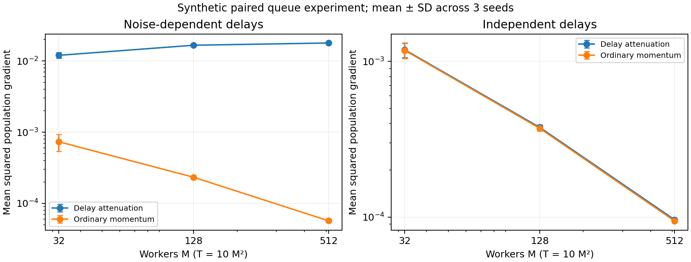

# Can lossless asynchronous training still have an unavoidable statistical penalty?

**Research screen and provisional theory plan — 15 October 2026.**

## 1. Decision

**Self-review update:** deprioritized as an active paper direction. Existing work addresses the general delayed-information obstruction and supplies practical buffering repairs. Our exact worker/gap/noise lower-bound scaling has unestablished novelty, and no consequential failure beyond these repairs has been demonstrated at equal wall-clock cost. The derivations below are retained as scoped findings; the research program is conditional background.

The earlier ranking/rating fusion and verifier-audit directions are rejected as active method proposals: established baselines repair their constructed failures. This pass also rejects generic conditional alignment, protein-order corrections, sparse steering composition and another stale-rollout loss.

The most defensible surviving **research question** is:

> What accuracy can a continuously refilled asynchronous training pipeline guarantee when slow samples carry information unavailable in completed samples? Which buffering, service-tail or observation assumptions are necessary to recover the usual statistical rate?

This is a theory of what a pipeline can learn before its informative jobs finish. It has a stronger foundation than the previous proposals because the scoped information lower bound below applies to every optimizer using the same observed transcript. Ordinary momentum cannot repair missing information. Buffering changes the observation contract and therefore is an essential comparator.

**Do not treat this as a validated full-paper proposal yet.** We have a derived lower bound for an explicit oracle class, a focused literature screen and synthetic experiments. We do not have a general matching upper bound, established novelty against all delayed-feedback literature, or evidence of this irreducible mechanism in LLM training. A mathematical counterexample alone does not establish publication value.

### A version check that removes an apparent contribution

Our initial audit examined the May v1 of [Bringing Order to Asynchronous SGD](https://arxiv.org/html/2605.02043v1). Its intermediate variance inequality fails under the certificate in Section 7. However, the [current October 4 v3](https://arxiv.org/html/2605.02043v3), Assumptions 2.3–2.4 and Theorems 3.1–3.2, separates independent delays from data-dependent delays, bounds the latter's stochastic gradients, and retains a worker-dependent remainder. Appendix B.5 uses all launched noise in its martingale decomposition. **The correction is already in the current paper. Our v1 audit provides no current novelty claim.**

The remaining lead is the necessity and sharpness of restrictions such as these, with a precise completion and observation budget. It does not rest on declaring the revised theorem wrong.

## 2. Scope and literature screen

The [26-paper corpus](../../reports/dpo_expanded/01_expanded_literature_analysis.md) provided the starting map. This pass focused on relevant conditional-alignment, protein and asynchronous-training material, then searched related primary sources through 15 October. It was not an exhaustive systematic review or another full reread of every corpus paper. Bounded native research workers shared this session; their criticism is not external peer review. No new OpenReview discussion audit was completed in this pass.

| Paper and inspected scope | Intuition explanation | Insight behind the mechanism | Consequence for our research decision |
|---|---|---|---|
| [ECLIPTICA/CITA, v1](https://arxiv.org/html/2601.06157v1), §3, D.5, L.1, M.2 | Train the model to associate an instruction with a particular preferred behavior. | A control instruction changes which behavior is requested; it does not guarantee that two competing attributes compose. Its anchoring expression and analyzed divergence must also be distinguished. | Composition failures motivate a question, but do not defeat ordinary instruction-conditioned preference training. Reject a new loss on this evidence. |
| [MAESTRO, October](https://arxiv.org/html/2610.04845v1), method and evaluation | Train across preferences while an adversary chooses where the policy needs improvement. | Preference coverage is itself an optimization variable. A generic proposal to improve multi-objective coverage has a close existing competitor. | Mandatory baseline; reject generic preference-conditioned coverage as novelty. |
| [Steering Interference Reflects the Model's Defaults, September](https://arxiv.org/html/2609.06951v1), §§4–8 | A perturbation can move several behaviors toward the model's defaults, regardless of the intended direction. | A geometric overlap between directions is symmetric; behavioral effects can be asymmetric. Decodability also does not establish controllability. | A real weakness of simple steering, but stronger conditioned or joint-control methods were not ruled out by our screen. Reject a repair proposal for now. |
| [ProtAlign](https://openreview.net/forum?id=m826DekCpp), §§3–5 and appendices | Compare protein sequences while accounting for several property objectives and random decoding orders. | It averages order-dependent probabilities before taking the log. Order Monte Carlo error, latent-order conditioning and property-oracle error are separate issues. | No checkpoint experiment demonstrates a consequential unresolved order-estimation failure. A Jensen correction is insufficient. |
| [Ordered Momentum, NeurIPS 2024](https://proceedings.neurips.cc/paper_files/paper/2024/file/1e5cff01121223de917a84a242de30a5-Paper-Conference.pdf), algorithm and assumptions | Try to give an out-of-order gradient the weight it would have received in an ordered stream. | Matching a nominal temporal weight does not automatically preserve statistical cancellation when completion order depends on the sample. | Ordered weighting itself is established. |
| [Asynchronous SGD Beats Minibatch SGD, NeurIPS 2022](https://proceedings.neurips.cc/paper_files/paper/2022/file/029df12a9363313c3e41047844ecad94-Paper-Conference.pdf), Theorems 2–3 and Assumption 1 | Analyze a virtual sequence and count pending workers instead of charging every update for the worst delay. | The sharp smooth rate uses delay–sample independence; the dependent-delay result needs stronger gradient control. | Strong theoretical baseline. Arbitrary-delay guarantees must be read with their sample-dependence assumptions. |
| [Bringing Order, current v3](https://arxiv.org/html/2605.02043v3), §2, Theorems 3.1–3.2, Appendix B.5 | Separate launched-gradient noise from the gradients still missing. | An informative pending set cannot be removed from a martingale as though it were chosen independently. | Current repair already exists. The bounded-gradient restriction and its rate penalty are the residual theoretical objects to study. |
| [GMC-GRPO, October](https://arxiv.org/html/2610.01896v1), Assumption 3, B.1, Remark 6 and experiments | Cap excessive aggregate importance mass within a stale rollout group. | Response-dependent delays violate the conditional sampling assumption, yet its length-coupled experiments report successful training. | Theoretical exclusion is not evidence that GMC fails in practice. Do not propose another generic staleness correction. |
| [ERNIE 5.0](https://arxiv.org/html/2602.04705v1), §4.1 | Keep training batches in their assigned order while prefetching later rollouts. | Scheduling affects which difficulty distribution reaches the learner at each update. Its U-RB buffer already enforces ordering without stopping all inference. | Establishes pipeline relevance and a strong repair. No measured buffering-versus-GMC frontier was established in our reading. |
| [Basis Rotation, ICML 2026](https://arxiv.org/html/2602.03515v2), pipeline method and experiments | Transport stale adaptive updates into a more suitable current basis. | Parameter drift and informative sample completion are distinct mechanisms. | A strong staleness baseline, not a proof that hidden slow-sample information has become available. |
| [Stochastic Multi-Armed Bandits with Unrestricted Delay Distributions, ICML 2021](https://proceedings.mlr.press/v139/lancewicki21a/lancewicki21a.pdf), Theorem 6, pp. 7–8 | Delayed outcomes can hide which arm is better when outcome and delay are coupled. | Two populations can reveal identical timing and feedback until their informative outcomes arrive. | The delayed-information obstruction and indistinguishability technique already exist. Our proposed worker/gap/noise scaling must add substantially to this prior result. |

This screen is search-bounded. In particular, the information-theoretic argument below uses standard two-point indistinguishability and a one-sided probability inequality. Those tools are not contributions. The ICML 2021 delayed-bandit result already uses the central hidden-information argument. Whether our precise mandatory-refill optimization scaling and a complete matching theory add a substantial new result remains unresolved.

## 3. Practical problem and limits of current evidence

Variable-length language examples, reasoning rollouts and code execution can have sample-dependent service times. The practical decision is how much completed work to consume before waiting for jobs that may contain different training information. The intended use cases are rollout scheduling, replay-buffer design and deciding whether a throughput gain also improves time to held-out quality.

The source evidence establishes relevance, not our explanation of production failures. ERNIE describes shifting difficulty under completion-based scheduling and already supplies U-RB. GMC succeeds in its simulated length-delay setting. Our queue is deliberately more adversarial than either reported experiment. Its very long slow service is a legal stress condition, not a measured property of a deployed system.

**Lossless does not imply a permanent sampling-frequency bias.** For bounded sample statistic $h$, let $\mathcal L_T$, $\mathcal A_T$ and $\mathcal P_T$ denote launched, arrived and pending jobs. If each job returns once,

$$
\sum_{k\in\mathcal L_T}h_k-\sum_{k\in\mathcal A_T}h_k
=\sum_{k\in\mathcal P_T}h_k,
\qquad
\left|\sum_{k\in\mathcal P_T}h_k\right|\le M\|h\|_\infty.
$$

The unresolved risks are finite-horizon missing information, unequal update weights and adaptive parameter paths. A theorem about them must not be presented as a population-frequency imbalance that persists forever.

## 4. Original theoretical result: a completion-budget lower bound

**Status:** derived here and checked algebraically, not externally peer reviewed; novelty not established.

### 4.1 Operational contract

There are $M\ge2$ workers. Initially all receive one fresh sample. Every completion is immediately replaced by one fresh independent sample. No cancellation, selective resampling, extra oracle query or wait for a complete cohort is permitted. The learner may otherwise choose its parameters and update rule arbitrarily, including ignoring gradients or keeping a momentum buffer.

The learner sees launch and completion times and completed gradients. A sample's hidden target is unavailable until its gradient returns; metadata or partial results do not disclose its sign. Worker samples and the algorithm's random coins can be coupled across two populations. This hidden-information condition is essential: a coordinator that can directly inspect the missing labels has a different oracle.

The performance budget is $T$ completions, not elapsed GPU time and not a fixed number of fully observed launch cohorts. After the $T$th refill, $n=T+M$ samples have been launched. All services are finite, so all jobs eventually return.

### 4.2 Two indistinguishable populations

Set

$$
p=\frac{M}{4(T+M)},\qquad
B=\frac{\sigma}{\sqrt{p(1-p)}},\qquad
\delta=pB.
$$

In population $s\in\{-1,+1\}$, a sample target is $R=0$ with probability $1-p$ and $R=sB$ with probability $p$. Common jobs have service one; rare jobs have service $D>T+1$. Their service times reveal rarity but not $s$.

First use sample loss $\ell(x;R)=(x-R)^2/2$. Both population objectives are smooth and lower bounded, the oracle variance is $\sigma^2$ uniformly, and

$$
\nabla f_s(x)=x-s\delta,\qquad
x_s^*=s\delta,\qquad
\Delta=f_s(0)-f_s(x_s^*)=\frac{\delta^2}{2}.
$$

This construction uses ordinary independent launch samples. It does not use a population assigned permanently to one slow worker.

### 4.3 Probability of seeing no informative completion

Let $N$ count rare outcomes among the first $n$ launch samples. Then $\mathbb E N=M/4$ and $\operatorname{Var}(N)\le M/4$. Cantelli's inequality gives

$$
\Pr(E):=\Pr(N\le M-1)\ge\frac{9M}{9M+4}.
$$

On $E$, at least one worker remains able to return a common job throughout the first $T$ completions. Those completions finish by time $T+1<D$. Hence no rare gradient returns. The two populations produce exactly the same observed transcript, including timing and pending statuses. The algorithm therefore chooses the same $x_t$ in both populations on this event.

For every such parameter,

$$
\frac{(x_t-\delta)^2+(x_t+\delta)^2}{2}
=x_t^2+\delta^2\ge\delta^2.
$$

Nonnegativity outside $E$ then implies that at least one of the two populations satisfies

$$
\frac1T\sum_{t=1}^T\mathbb E\left|\nabla f_s(x_t)\right|^2
\ge\frac{9M}{9M+4}\,\frac{\sigma^2p}{1-p}.
$$

This conclusion holds for any update rule under the contract. It is not a counterexample specifically to DPO, Adam or momentum.

### 4.4 Consequence for a uniform rate

For $T=M^2$,

$$
\delta^2=\frac{\sigma^2}{4M+3},\qquad
\Delta=\frac{\sigma^2}{2(4M+3)}.
$$

The lower bound is of order $\sigma^2/M$, whereas the proposed delay-independent rate shape, with $L=1$, is

$$
\frac{L\Delta M}{T}+\frac{\sigma\sqrt{L\Delta}}{\sqrt T}
=O\!\left(\frac{\sigma^2}{M^2}+\frac{\sigma^2}{M^{3/2}}\right).
$$

Consequently no universal constant makes that rate valid over this completion-driven oracle class. The numeric lower-bound-to-rate-shape ratio grows from 3.67 at 32 workers to 180.77 at 65,536; these numbers only check the displayed algebra. The asymptotic argument establishes the contradiction.

**Scope matters:** the instance distribution and initial gap vary with $M$. This rules out a uniform guarantee with the displayed dependence on $\Delta$. It does not prove a worse exponent for every fixed distribution, nor a stronger lower bound for a fixed positive initial gap.

### 4.5 Bounded-gradient strengthening

The same information argument can use globally bounded gradients. Replace the quadratic loss by a Huber loss $h_C(x-R)$, with threshold $C=2B$ and derivative

$$
h_C'(u)=\operatorname{clip}(u,-C,C).
$$

Each sample loss is convex, nonnegative and one-smooth, with stochastic gradient bound $G=2B$. Since clipping is one-Lipschitz, the two-point gradient variance is at most $p(1-p)B^2=\sigma^2$ at every $x$. For $|x|\le B$ the population gradients remain $x-s\delta$. Outside that interval both population gradients have magnitude at least $(1-p)B\ge\delta$. Thus the same paired lower bound holds for arbitrary parameter choices. The minimizers and initial gap are unchanged.

Along $T=M^2$, this family has $G$ of order $\sigma\sqrt M$ and $\Delta$ of order $\sigma^2/M$. Accordingly,

$$
\left(\frac{GL\Delta M}{T}\right)^{2/3}
=\Theta\!\left(\frac{\sigma^2}{M}\right).
$$

Our lower bound matches the scale of that extra term **along this parameter family**. It does not establish a general minimax formula for independently prescribed $G,\Delta,M,T$.

### 4.6 Why standard repairs do not invalidate this result

An ordinary optimizer cannot infer the sign from an identical transcript. Clipping or robust aggregation can stabilize estimates but cannot reconstruct unseen information. Launch-order buffering or synchronous minibatching can wait for the rare jobs and distinguish the populations; they leave the forced-refill completion contract. Synchronous minibatch SGD already attains the usual rate in completed-gradient count after waiting for full batches. Therefore the open question must concern the accuracy–service tradeoff of a specified streaming pipeline, not whether some parallel algorithm achieves the usual rate.

This theorem does not establish that buffering is too slow: prefetching can reduce its cost. Nor does it give a universal wall-clock impossibility beyond the fact that an unbounded finite service class has no uniform latency ceiling.

## 5. Executed experiments and ablations

The [runner](run_experiments.py) executed 27 paired trials: 32, 128 and 512 workers; three seeds; three service conditions. Both methods receive precisely the same noise and queue events. The objective is $f(x)=x^2/2$, with gradient $x+\varepsilon$, $x_0=0.1$, $L=\sigma=1$, and $T=10M^2$.

Noise is $1/\sqrt{15}$ with probability $15/16$ and $-\sqrt{15}$ otherwise. All initial jobs take one unit, worker 0 returns first, and other initial gradients are zeroed to follow the inspected ordered-momentum algorithm. Subsequent slow jobs take $10^9$ virtual units. The compared methods are

$$
m_t^{\rm ord}=(1-\beta)m_{t-1}^{\rm ord}
+\beta(1-\beta)^{\tau_t}g_{t-\tau_t}^{\rm ord},
\qquad
m_t^{\rm ordinary}=(1-\beta)m_{t-1}^{\rm ordinary}
+\beta g_{t-\tau_t}^{\rm ordinary}.
$$

Both update $x_{t+1}=x_t-\eta m_t$. Parameters use the **v1 schedule** $\beta=\min\{1/[16(M-1)],\sqrt{5\Delta/T}\}$ and $\eta=\beta/\sqrt8$. These are mechanism tests, not a reproduction or refutation of the current v3 theorem. That version changes assumptions and schedules; this quadratic has no global bounded-gradient constant.

| Delay condition | Workers | Ordered attenuation: mean squared gradient | Ordinary momentum: mean squared gradient |
|---|---:|---:|---:|
| Negative noise is slow | 32 | 0.011998 ± 0.001089 | 0.000734 ± 0.000197 |
| Negative noise is slow | 128 | 0.016634 ± 0.000333 | 0.000232 ± 0.000008 |
| Negative noise is slow | 512 | 0.017891 ± 0.000092 | 0.0000569 ± 0.0000009 |
| Slow marker independent of noise | 32 | 0.001187 ± 0.000130 | 0.001177 ± 0.000133 |
| Slow marker independent of noise | 128 | 0.000377 ± 0.000015 | 0.000372 ± 0.000014 |
| Slow marker independent of noise | 512 | 0.0000961 ± 0.0000003 | 0.0000943 ± 0.0000004 |
| Equal service | 512 | 0.0000966 ± 0.0000010 | 0.0000945 ± 0.0000010 |

Values are means ± sample standard deviations over three seeds, not confidence intervals. [All trials](results.csv) and [analytical checks/configuration](run_manifest.json) are retained.

At 512 workers with informative delays, completed raw noise averages 0.000520 while the attenuated-noise sum per update averages 0.130182. Positive gradients retain mean attenuation 0.998347; negative gradients retain 0.461494. The runner checks the lossless launched-minus-arrived-equals-pending identity. Independent slow markers remove most of the performance separation.

**Interpretation:** weighting can create a failure despite nearly correct raw completion frequencies, and ordinary momentum repairs this fixture. Therefore these experiments do not justify a new optimizer. The information lower bound in Section 4 concerns a different, rarer-information regime; its validity comes from indistinguishability, not from this repaired experiment.

No GPU training, actual throughput measurement, benchmark reproduction or real rollout-tail distribution was executed. Three seeds and a one-dimensional objective cannot establish practical superiority or the typicality of the mechanism.

## 6. Provisional research program

### Candidate contribution

Working question: **characterize the necessary statistical penalty and the minimum observation or scheduling change that removes it under informative completion delays.**

A full theoretical paper would need all three components:

1. A lower bound for an explicit, practically relevant oracle/service model with informative pending jobs. Section 4 supplies a restricted first result.
2. A matching or meaningfully improved upper bound in the same model, with parameters describing completion budgets, sample tails and permitted buffering. This is open work here.
3. A decision rule or empirical frontier showing when a real pipeline should buffer, continue streaming or limit influence. Without this, the result may be a small theoretical observation.

A useful analytical quantity to explore is the tail energy of the pending gradient noise,

$$
\mathcal E_T=\mathbb E\sum_{k\in\mathcal P_T}
\left\|g_k-\nabla f(x_k)\right\|^2.
$$

This is a proposed analytical object, not a proven sufficient statistic or novelty claim. It distinguishes a few harmless pending jobs from a few jobs carrying most of the oracle's information. Launch martingale arguments and robust mean estimation are existing tools; a new theorem must show what the service coupling adds.

### Theory steps and hard gates

| Step | Required result | Stop or narrow if |
|---|---|---|
| Oracle formalization | Precisely specify job visibility, partial-response leakage, refill, cancellation, gradient reuse and output budget. | The intended pipeline already reveals the hidden information used by the lower bound. |
| Novelty audit | Compare full theorem contracts against endogenous-delay optimization, delayed bandits, censored feedback and robust mean estimation. | An existing result implies the lower bound and intended upper bound without a substantive extension. |
| Parameter lower bound | Extend beyond one $T=M^2$ curve; state which $\Delta,G,\sigma$ can vary independently. | The claimed general minimax characterization cannot be supported. |
| Achievability | Prove a matching bound for a permitted streaming/buffering algorithm. | The result is merely the standard synchronous minibatch guarantee under renamed assumptions. |
| Practical bridge | Show that missing job information survives observable metadata and partial rollout outputs. | Length or prompt conditioning, ordinary momentum or U-RB resolves the real phenomenon at comparable cost. |

### Experiment plan and expected outcomes

**First realistic test:** instrument an existing rollout implementation. Log launch policy, prompt identity, completion length, partial visibility, readiness time, reward/correctness, and whether a sample is deferred, cancelled or reweighted. Use at least a reasoning task with executable answers and a second task with a different length–reward relationship. The choice of models and datasets remains to be tied to available hardware and verified current releases.

Replay identical launched jobs into ordinary async momentum/SGD, AdamW, the relevant importance-corrected post-training baseline, and launch-order buffering with prefetch. Use each baseline's proper objective and tune it at the same budget. Report held-out correctness versus generated tokens, optimizer updates, measured elapsed time and GPU-hours. An update-only comparison cannot decide production value.

**Ablations:** independently permute service times; reveal prompt/length metadata; reveal partial outputs; drain the final queue; vary concurrency and buffer size; clip influence; replace heavy tails with bounded/light tails; vary the reward–length association; compare fixed versus changing behavior policies. These distinguish hidden information, weighting, censoring and parameter drift.

**Expected, not measured:** decorrelating service and feedback should weaken the effect; draining or buffering should remove missing-information ambiguity; informative metadata should reduce the lower bound's practical relevance. Heavy-tailed influence may increase a streaming penalty. A throughput advantage might still dominate that penalty. All of these predictions are falsifiable.

### Venue and impact assessment

An ICML/NeurIPS/ICLR theory submission would require a substantial new characterization with matching guarantees and clear assumptions. An ACL/EMNLP submission would additionally require language-specific evidence and a useful pipeline decision. The lower bound alone does not satisfy either package. The current practical impact is unresolved, and no acceptance probability is warranted.

## 7. Historical audit certificate: v1 only

For reproducibility, we retain the exact finite-horizon certificate that led to the version check. It is not a proposed contribution against the current paper.

Take $f(x)=0$, sample loss $\varepsilon x$, and the two-point noise used in Section 5. Let $M=64$, $T=512$, $\beta=1/1008$, $c=1-\beta$, and $\eta=\beta/100$. Every initial job takes one unit independently of its noise; deterministic ties return worker 0 first. The source rule zeroes other initial gradients. Later positive jobs take one unit and negative jobs take $10^6$ units.

Let $F$ be a positive first gradient, probability $15/16$. Let $E$ be at most 63 negatives among the first 512 subsequent launches. Its probability is at least $512/527$ by Cantelli; $E$ and $F$ are independent. On their intersection all subsequent arrivals before $T$ are positive, initial jobs finish within 64 arrivals, and each positive update lag is at most $2M$. Therefore

$$
m_t\ge\frac{c^{2M}}{\sqrt{15}}(1-c^{t-M}),\qquad t>M.
$$

The virtual error equals $m_t$ for this flat population objective. Consequently

$$
V:=\frac1T\sum_t\mathbb E[m_t^2]
\ge\frac{c^{256}}{8432}\sum_{j=1}^{448}(1-c^j)^2
=0.0019778215166249137.
$$

The v1 Appendix A.3 inequality instead implies $V\le\beta+10^{-4}V$, hence $V\le0.0009921627083343254$. Python rational arithmetic verifies the strict contradiction. Individual sample losses here need not be lower bounded; the inspected v1 nonconvex assumptions require the population objective to be lower bounded. All services are finite and the initial used oracle is unbiased.

This certificate refutes the scoped v1 inequality under the iid-per-launch reading. It does not independently refute a full convergence theorem: the flat population gradient is zero. **The current v3 changes the proof and assumptions, so this certificate must never be reported as a counterexample to its data-dependent theorem.**

## 8. Final self-review

The latest lead avoids the earlier logical mistake: within its stated oracle class, the central failure is information-theoretic and applies to standard optimizers too. It also makes its limits explicit: buffering can change that class, hidden-label assumptions may not match an LLM pipeline, and the current paper already contains the proof repair we initially thought was missing.

**Decision after practical-solution review:** deprioritize this direction as an active paper candidate. Retain the completion-budget lower bound as a scoped theoretical finding with unestablished novelty. Reject a new delay-weighting method and an older-version correction paper. Reconsider only if existing buffering and correctly configured optimization methods leave a consequential failure under realistic observations at comparable measured cost.

The practical remedy is conceptually straightforward: wait for a complete assigned group, buffer arrivals, or preserve launch order while prefetching. Engineering that remedy efficiently may be difficult, but we have not demonstrated a significant unresolved cost. Our lower bound excludes waiting for complete cohorts and stops before rare informative jobs return. That restriction makes the theorem meaningful for its chosen oracle class; it does not establish an unmet production need. The 27 experiments also test a different attenuation fixture that ordinary momentum repairs. They cannot justify a claim that all practical alternatives fail.
