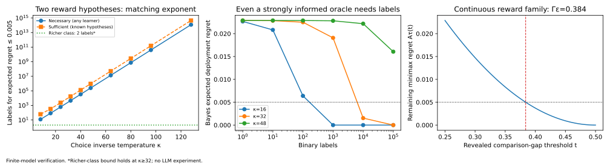

# Policy restrictions determine the statistical cost of preference alignment

**Research proposal and theoretical sprint 0 — 15 October 2026**

**Decision after the focused novelty and practical-repair audit: retain the theorem, but withhold a full-project recommendation.** The deliverable is a theoretical characterization, a constructive statistical procedure, two explicit class separations, and reproducible numerical checks. The broad premise is already addressed in prior work, and the contextual example has a simple representation repair. The precise theorem's contribution strength remains unresolved. See Section 11 for the audit and the additional executed check.

## 1. The proposed research direction

> **Which distinctions in preference strength must be learned to optimize the policy class we can actually deploy?**

The central idea is that the required feedback depends jointly on **the deployment policy class, the available comparisons, the regularization, and the desired accuracy**. Highly reliable labels may tell us which responses win while revealing almost nothing about the magnitudes needed to make unavoidable tradeoffs inside a restricted model.

This suggests a counterintuitive possibility: a more expressive policy can require substantially less preference information. It can satisfy preferences independently, whereas a smaller policy must learn how to compromise between them. This is an existence result, not a general rule that larger models always need fewer labels.

### What is already established in this sprint

1. A lower bound covering **every adaptive comparison-based learner**, including correct reward-model estimation followed by exact policy optimization.
2. A matching leading exponential rate for compact, continuous reward classes, using the remaining deployment ambiguity after small reward gaps become observable.
3. A constructive upper-bound procedure with an explicit finite-sample estimation term. Its deployment optimization is oracle-based; computational efficiency is not established.
4. An exactly solvable two-prompt example: a shared policy parameter needs at least **7,180 labels** for expected deployment regret at most 0.005 at the stated confidence setting. Two independently adjustable parameters admit a two-label rule with worst-case expected regret approximately **0.00004195**.
5. Numerical checks of a second, three-response example, including a continuous reward family and accuracy-dependent sample exponents.

All findings in this list are derived here. They are not results reported by the source papers, externally peer-reviewed theorems, or measured effects in LoRA training.

## 2. Why this is a real research question

The supplied corpus exposes a compatibility issue between preference fitting and reachable policy improvement. [AuxDPO](https://proceedings.iclr.cc/paper_files/paper/2026/hash/8f6c674a7edf57912f1a5830f4a66e3f-Abstract-Conference.html), §§2–4, shows that a restricted policy manifold can make the DPO likelihood compromise disagree with the best achievable RLHF policy. Its auxiliary-variable construction addresses that estimation geometry. It does not determine how much preference information any algorithm needs to identify the restricted optimum.

The supplied [Coverage Improvement](https://arxiv.org/html/2601.08421v1) paper, §2.1 Assumption 2 and §§3–4, analyzes fast improvement when the target Boltzmann policy is realizable in the policy features. Our question concerns information requirements when deployment imposes a conflicting restriction. The theorem below grants arbitrary access to the allowed response pairs, so the difficulty is not caused by failure to sample an action.

The broader practical concern is already documented. [Whitfill and Slocum](https://arxiv.org/html/2508.08486v1), §3.2 and Theorem 4.1, show that ordinal response preferences need not identify the most preferred feasible model; §4.1 discusses the limitations of using nearly deterministic BT comparisons to recover magnitude. **We do not claim that qualitative insight as new.** The proposed contribution is a quantitative, deployment-dependent characterization under a correctly specified, known BT model with stochastic labels.

### Practical use cases to investigate

| Pipeline decision | Potential relevance | Evidence still required |
|---|---|---|
| Choosing a constrained adapter or shared control representation | Shared parameters may force tradeoffs requiring preference magnitudes that a more flexible representation would not need. | Show a natural conflict under real adapters; the scalar examples do not prove this happens in LoRA. |
| Reward-model training followed by restricted policy optimization | Good ranking recovery may coexist with uncertainty about the best feasible policy. | Measure ambiguity in deployment value, rather than only held-out pair accuracy. |
| Collecting highly consistent judge labels | Greater certainty can make rankings easier while making magnitude estimation harder. | Calibrate whether the real judge follows a stable stochastic link; deterministic labels do not identify a BT scale automatically. |
| Deciding whether additional comparisons can resolve an alignment failure | The result separates missing information from a poor optimizer. | Include the actual decoder, reranking, retrieval, and permitted postprocessing in the deployment class. |

These are hypotheses for application. No deployment-impact claim is established yet.

## 3. Closest work and the proposed contribution boundary

| Primary source | Intuition and relevant result | What this proposal must add |
|---|---|---|
| [Beyond Ordinal Preferences](https://arxiv.org/html/2508.08486v1), §3.2, Theorem 4.1, §4.1 | Different feasible models resolve tradeoffs differently; ordinal wins can omit their importance. | A finite-feedback statistical law with a known stochastic link, continuous reward classes, fixed regularization, and a specified regret tolerance. |
| [Near Optimal Pure Exploration in Logistic Bandits](https://arxiv.org/html/2410.20640), §2, Theorem 4.1 | Learning a decision can be formulated as distinguishing logistic models inducing different answers. | Explicitly evaluate the high-confidence-label regime through continuous clipped-gap fibers, rather than present generic testing machinery as novel. |
| [Pure Exploration in Bandits with Linear Constraints](https://proceedings.mlr.press/v238/carlsson24a.html), §§3–4 | Feasible mixtures change which reward alternatives matter for a decision. | Handle comparison feedback and continuous restricted policy classes, including the stated exponential capacity separation. |
| [Tight Guarantees with the Decision-Estimation Coefficient](https://proceedings.mlr.press/v195/foster23b.html), §§1.1–1.3 and PAC results | Information is useful when it changes a final decision; randomized decisions and Hellinger information are established tools. | A structural evaluation of that information requirement in saturated BT experiments. The general decision-theoretic perspective is existing work. |
| [Saturation-Insensitive Dueling Bandits](https://arxiv.org/html/2609.33011v1), §§3–5 | Good comparator selection can improve regret against freely selected best actions. | Explain a different target: an optimal shared deployment policy whose required tradeoffs can remain hidden even with arbitrary allowed-pair queries. |
| [Stochastically Dominant Preference Optimization](https://www.ifaamas.org/Proceedings/aamas2026/pdfs/KBIV4686.pdf), Definition 1 and Proposition 2 | Improving upper-tail masses can improve every ranking-consistent utility. | Statistical query complexity and its dependence on deployment ambiguity. Stochastic dominance is not a new ingredient here. |

**Novelty assessment.** The inspected sources contain the conceptual motivation and major proof tools. This search did not find the continuous clipped-fiber exponent law stated below. That is a bounded search finding, not proof of priority. A reviewer could still regard the result as a specialization of statistical decision theory; the continuous result, explicit capacity separation, and useful empirical consequences must carry the contribution.

This pass used primary manuscripts and existing corpus notes. It did not newly read OpenReview discussions or use the OpenReview API.

## 4. Mathematical setup

There are finitely many contexts and responses, with a fixed context distribution. A utility vector $u$ lies in a known compact set $\mathcal U\subseteq[0,1]^K$, where coordinates index context–response outcomes. The deployment policy belongs to a known nonempty compact class $\Pi$. Let $q$ be a full-support reference and $\tau>0$ a fixed KL coefficient.

Write the normalized deployment objective and regret as

$$
J_u(\pi)=\mathbb E_{x,a\sim\pi}[u(x,a)]
-\tau\mathbb E_x\mathrm{KL}(\pi(\cdot\mid x)\|q(\cdot\mid x)),
\qquad
L_u(\pi)=V_\Pi(u)-J_u(\pi),
\qquad
V_\Pi(u)=\max_{\pi\in\Pi}J_u(\pi).
$$

The allowed comparison set $E$ is finite. For example, it may contain every response pair within each prompt. Utilities share a strict orientation on each allowed edge. Orient edge $e$ from the preferred to the dispreferred response, and let $d_e(u)>0$ be its utility gap.

The learner can adaptively select any allowed edge. Conditional on that selection, labels are independent with

$$
\Pr_u(\text{preferred response wins on }e)
=\sigma(\kappa d_e(u)),
\qquad \sigma(z)=(1+e^{-z})^{-1}.
$$

The known parameter $\kappa$ controls label confidence. **Varying it does not change the deployment objective.** In the unit-temperature reward convention, this is equivalent to scaling reward to $\kappa u$ and the KL coefficient to $\kappa\tau$.

The learner may randomize its final recommendation. Define fixed-budget minimax **expected** regret and its required budget by

$$
\mathcal R_\kappa(N)=
\inf_{\mathcal A}\sup_{u\in\mathcal U}
\mathbb E_u[L_u(\widehat\pi_{\mathcal A})],
\qquad
N_\kappa(\varepsilon)=\min\{N:\mathcal R_\kappa(N)\leq\varepsilon\}.
$$

If $q_{\min}$ is the smallest reference probability, regret is bounded by

$$
0\leq L_u(\pi)\leq B:=1+\tau\log(1/q_{\min}).
$$

The results concern this experiment. They do not cover an unknown link, arbitrary inconsistent human preferences, queries comparing policies' expected utilities, or extra cardinal measurements.

## 5. The central theoretical result

### 5.1 Which information becomes observable?

With roughly $e^{\kappa t}$ labels, upset probabilities associated with gaps larger than $t$ can remain effectively invisible. The object of interest is the clipped gap signature

$$
\psi_t(u)=\bigl(\min\{d_e(u),t\}\bigr)_{e\in E}.
$$

Its fiber at $z$ is $C_t(z)=\{u\in\mathcal U:\psi_t(u)=z\}$. All utilities in a fiber agree on the small gaps already resolved; the larger gaps remain censored.

Measure the best deployment decision possible while that ambiguity remains:

$$
D_\tau(C)=\inf_{\nu\in\mathcal P(\Pi)}
\sup_{u\in C}\mathbb E_{\pi\sim\nu}[L_u(\pi)],
\qquad
A_\tau(t)=\sup_{z\in\psi_t(\mathcal U)}D_\tau(C_t(z)).
$$

Here $\mathcal P(\Pi)$ denotes distributions over permitted deployment policies. This handles randomizing which model is selected without silently enlarging the class of individually deployed models.

### 5.2 Lower bound: all adaptive learners

For every fixed budget and every $t\geq0$,

$$
\boxed{\mathcal R_\kappa(N)
\geq A_\tau(t)-BN e^{-\kappa t}.}
$$

**Proof.** Fix a fiber. On an edge with gap below $t$, every utility in the fiber gives exactly the same label law. On the other edges, replace the label by the common ranking winner. Each replacement changes the experiment with probability at most $e^{-\kappa t}$. This coupling remains valid when the algorithm chooses its next query adaptively. The total probability of any discrepancy is at most $Ne^{-\kappa t}$. Under the resulting common experiment, the output law is one randomized decision independent of the true utility inside that fiber. Its worst-case regret is at least the fiber's decision radius. Bounded regret costs at most the displayed coupling term; take the supremum over fibers.

This includes a learner with the correct reward class, an unlimited optimizer, and arbitrary allowed-pair selection. No weighting or optimization method can remove the bound while keeping the experiment and deployment class fixed.

### 5.3 Constructive upper bound, including continuous reward classes

Sample every edge $n$ times, for $N=mn$ and $m=|E|$. Let $\widehat p_e$ be the empirical upset frequency. Define

$$
p_t=\sigma(-\kappa t),\qquad
\widehat\psi_e=-\kappa^{-1}
\operatorname{logit}\!\left(
\operatorname{clip}(\widehat p_e,p_t,1/2)\right).
$$

For a failure probability $\zeta$, put

$$
a=\log(2m/\zeta),\qquad
r=\sqrt{\frac{2a}{np_t}}+\frac{2a}{3np_t},
\qquad \delta=\frac{4r}{\kappa}.
$$

When $r\leq1/4$, Bernstein's inequality and a clipped-logit bound give, uniformly over the compact utility class,

$$
\Pr_u\!\left(\|\widehat\psi-\psi_t(u)\|_\infty\leq\delta\right)
\geq1-\zeta.
$$

Project the estimate to a nearest point $z$ of the compact image $\psi_t(\mathcal U)$. The true signature then lies within $2\delta$ of $z$. Recommend a minimax policy lottery for that neighborhood. With

$$
A_{\tau,\eta}(t)=
\sup_{z\in\psi_t(\mathcal U)}
D_\tau\!\left(\{u\in\mathcal U:
\|\psi_t(u)-z\|_\infty\leq\eta\}\right),
$$

the procedure satisfies

$$
\boxed{\mathcal R_\kappa(mn)
\leq A_{\tau,2\delta}(t)+B\zeta.}
$$

**Why the continuous extension works.** Compactness and continuity imply $A_{\tau,\eta}(t)\downarrow A_\tau(t)$ as $\eta\downarrow0$. To see this, take a sequence of worst-case neighborhood centers converging to a limiting center. Every limit of utilities in their shrinking neighborhoods belongs to the limiting exact fiber. Evaluate those neighborhoods using an optimal decision for that fiber; continuity bounds their limiting risk by its radius.

Compactness alone supplies no explicit rate for this last convergence. The finite-sample bound is valid but contains a geometry-dependent ambiguity modulus. Projection and minimax optimization are statistical oracles here.

### 5.4 Matching leading exponent

The lower and upper bounds yield

$$
\sup\{t\geq0:A_\tau(t)>\varepsilon\}
\leq\liminf_{\kappa\to\infty}
\frac{\log\max\{1,N_\kappa(\varepsilon)\}}{\kappa}
$$

$$
\leq\limsup_{\kappa\to\infty}
\frac{\log\max\{1,N_\kappa(\varepsilon)\}}{\kappa}
\leq\inf\{t\geq0:A_\tau(t)<\varepsilon\}.
$$

Whenever the outer thresholds coincide, this identifies the exact exponential rate. A sufficient condition is that the target is not a nondegenerate plateau level of the ambiguity curve. If the comparison experiment never resolves a consequential ambiguity, the threshold can be infinite.

**Interpretation:** the exponent is determined by the last ambiguity that matters for the required deployment accuracy. It is not necessarily the smallest utility gap, the largest reward range, the number of parameters, or the accuracy of a reward classifier.

The upper construction uses uniform edge sampling. Thus adaptivity cannot improve this leading exponent under these assumptions; it may improve constants and lower-order terms. This is an expected-regret result, not a high-probability guarantee on each deployed model.

## 6. An exact capacity separation

### 6.1 Two prompts with incompatible preferred actions

Take two equiprobable prompts and two responses per prompt. Their utilities are

$$
u(x_1,\cdot)=(0,c),\qquad
u(x_2,\cdot)=(1/2,0),\qquad c\in[1/4,3/4].
$$

Every utility agrees on the rankings: response 1 is better on the first prompt; response 0 is better on the second. The unknown quantity is the relative importance of these improvements.

The smaller policy uses one shared logit:

$$
\pi_\theta(1\mid x_1)=\pi_\theta(1\mid x_2)=\sigma(\theta),
\qquad \theta\in[-16,16].
$$

Use a uniform reference and $\tau=0.01$. Writing $p=\sigma(\theta)$,

$$
J_c(p)=\frac14+\frac{c-1/2}{2}p
-\tau\mathrm{KL}(\operatorname{Bern}(p)\|\operatorname{Bern}(1/2)),
\qquad
\theta_c^*=\frac{c-1/2}{2\tau}.
$$

Thus the endpoint utilities require opposite optimal logits, $-12.5$ and $12.5$, despite having identical rankings. These optima lie inside the permitted interval.

### 6.2 A lower bound that includes reward fitting

For the two hypotheses $c=1/4$ and $c=3/4$, the equal-prior deployment ambiguity is exactly

$$
\Delta_\tau=\tau\log\cosh\!\left(\frac{1}{16\tau}\right)
=0.05556856546\ldots.
$$

The second prompt has the same label distribution under both hypotheses. On the first prompt their per-label total variation is

$$
d_\kappa=\sigma(3\kappa/4)-\sigma(\kappa/4).
$$

Adaptive coupling bounds transcript total variation by $1-(1-d_\kappa)^N$. The sum of the two hypothesis-specific regrets is at least $2\Delta_\tau$ for every recommended policy. Therefore every algorithm satisfies

$$
\boxed{\mathcal R_\kappa(N)
\geq\Delta_\tau(1-d_\kappa)^N.}
$$

At $\kappa=32$, expected regret at most 0.005 requires

$$
N\geq
\frac{\log(\Delta_\tau/0.005)}{-\log(1-d_{32})}
=7179.8875\ldots.
$$

Hence at least **7,180 labels are necessary**, not sufficient. The bound already grants the learner knowledge of both possible utilities and their common rankings. A fully specified reward model and exact policy optimizer cannot circumvent it.

Repeated comparisons and a likelihood-ratio test attain the same leading $e^{\kappa/4}$ dependence for this two-hypothesis problem. The code records both necessary and sufficient budget bounds; the latter is not claimed to be the optimal adaptive constant.

### 6.3 One additional adjustable parameter removes the compromise

Allow independent logits with the same coordinate bounds:

$$
\pi(1\mid x_i)=\sigma(\theta_i),\qquad
(\theta_1,\theta_2)\in[-16,16]^2.
$$

This class contains the smaller one. Its exact optimum for **every** allowed $c$ is $(16,-16)$: the unconstrained first logit is $c/\tau\geq25$, and the second is $-1/(2\tau)=-50$, so both clip to the stated bounds.

Both classes are compact, both have full support, both use the same reference and fixed KL coefficient, and both face the same response-comparison feedback. The separation does not rely on a deterministic policy boundary or on reducing the normalized KL penalty as confidence grows.

Given the common rankings, the richer class needs zero labels: its optimizer is already determined. As an operational positive control that does **not** use that ranking information, obtain one comparison per prompt and set its logit to $16$ or $-16$ according to the observed winner. Its worst-case expected regret at $\kappa=32$ is

$$
\tanh(8)\left[
\frac18\sigma(-8)+\frac14\sigma(-16)
\right]
=0.00004194689\ldots.
$$

**What the comparison means.** Each class is evaluated against its own best feasible policy. The result demonstrates different information requirements for different deployment decision problems. It does not claim that every increase in capacity reduces label requirements or that the classes achieve equal oracle values.

## 7. Continuous-family result and executed checks

A separate one-prompt example permits every response pair, so its lower bound cannot be blamed on missing cross-response queries:

$$
u_c=(0,1,c),\quad c\in[1/4,3/4],\qquad
\pi_\theta=\operatorname{softmax}(-\theta,0,\theta),
\quad\theta\in[-3,3].
$$

For $1/4<t<1/2$, the only non-singleton signature fiber is $c\in[t,1-t]$. Outside that interval, an observed smaller gap identifies $c$. Put $h_\tau(c)=\max_\theta J_c(\pi_\theta)$. Convexity of regret in $c$ and minimax duality give

$$
A_\tau(t)=\max_{\lambda\in[0,1]}
\left[
\lambda h_\tau(t)+(1-\lambda)h_\tau(1-t)
-h_\tau\bigl(\lambda t+(1-\lambda)(1-t)\bigr)
\right].
$$

Below $t=1/4$, use the whole interval; at $t\geq1/2$, all fibers are singletons. Thus the continuous reward class has a computable accuracy-dependent exponent. This is stronger than a two-world impossibility example.

### Executed numerical results

The [canonical program](experiment.py) produced [these results](results.json). No labels were collected from real people or LLM judges.

| Check | Observed result | Meaning |
|---|---:|---|
| Three-response, unregularized ordinal minimax regret | 0.02357494339 | Agrees with the analytic value $\sqrt{13}/6-1/\sqrt3$. |
| Three-response, $\tau=0.01$, grid minimax regret | 0.02287804665 | Preference ranking alone leaves material deployment ambiguity in this example. |
| Same example, target regret 0.01 | Exponent approximately 0.33562 | Predicted asymptotic label dependence is $e^{0.33562\kappa+o(\kappa)}$. |
| Same example, target regret 0.005 | Exponent approximately 0.38401 | Tighter deployment accuracy requires resolving a harder ambiguity. |
| Same example, target regret 0.002 | Exponent approximately 0.42674 | A single minimum-gap exponent would miss this dependence. |
| Two-prompt example, 1,000 labels at $\kappa=32$ | Any-learner regret at least 0.03973416 | Exact statistical lower bound. |
| Two-prompt example, two-label richer-policy rule | Worst-case regret 0.00004195 | Analytic positive control, verified numerically. |

The three-response numerical minimax calculations use 12,001 policy grid points. Its continuous reward interval is handled by endpoint minimax duality, not by pretending five sampled rewards exhaust that interval. The program separately computes continuous policy stationary points and checks the unregularized closed form. Grid error is documented in the JSON. Approximate exponents are numerical evaluations of the theorem, not empirical scaling measurements from trained models.

The Bayes-oracle checks grant knowledge of the two reward hypotheses and sum binomial outcome probabilities. They confirm that even this strongly informed learner obeys the lower bound. The oracle uses a fixed informative pair; optimal adaptive query constants were not computed.

## 8. Why the previous simple repairs do not settle this question

| Proposed repair | What happens under the theorem's experiment? |
|---|---|
| Fit a correctly specified reward model, then optimize the policy | Included in the lower bound. Finite saturated labels still leave consequential magnitude uncertainty. |
| Improve pair coverage or select pairs adaptively | Every allowed pair is already queryable; the lower bound covers adaptive selection. |
| Change DPO weights, clipping, reference treatment, or optimizer | These changes do not add information to the comparison transcript. |
| Repeat comparisons | Works eventually and supplies a matching upper exponent; it does not remove the exponential requirement in the hard class. |
| Expand the policy representation | Can remove the need for a compromise, as the nested-class example proves. This is a substantive change to the decision problem. |
| Return an identified top response, rerank candidates, or add retrieval | May change the effective deployment class and eliminate the obstruction. Such mechanisms must be included in any practical experiment. |
| Add calibrated scores, anchor outcomes, or policy-level comparisons | Changes the feedback experiment. These can help, but this proposal is not claiming a new ratings-fusion algorithm. |

The research contribution is to characterize **when** a particular feedback experiment can support the deployment decision, rather than to name another corrective preference loss.

## 9. Proposed complete-paper program

### 9.1 Theoretical contribution to retain

The main theorem should be the continuous clipped-fiber lower/upper characterization. The capacity examples demonstrate a consequence. Stochastic dominance, coupling, Bernstein's inequality, and minimax duality should be identified as established ingredients.

Remaining proof work should focus on a quantitative modulus for $A_{\tau,\eta}-A_\tau$ under useful regularity assumptions, and on a computationally tractable robust decision rule for a specified policy family. These would turn the oracle upper bound into an implementable procedure. High-probability regret, unknown judge links, and sequential stopping budgets require separate arguments and should not be implied by the present theorem.

### 9.2 First meaningful NLP experiment

Use a source-paper dataset and a fixed pool of multiple responses per prompt, with a separately held-out evaluation signal. Define a controlled capacity ladder with a frozen representation and increasingly flexible trainable heads, then test small actual adapters only if the head experiment supports the mechanism.

The hypothesis is: **some restricted classes require distinctions between reward magnitudes that are poorly identified by confident pair labels; expanding reachable policy directions can reduce that requirement.** This predicts a change in data requirements after expanding the class, not merely a higher reward ceiling.

Required comparisons:

| Arm | Purpose |
|---|---|
| Correctly specified tabular reward estimate on the candidate pool, followed by globally solved deployment optimization where feasible | Separate feedback uncertainty from reward-head misspecification and optimizer failure. |
| Flexible reward model plus the same policy class | Standard two-stage baseline. |
| DPO and AuxDPO with the same accessible labels | Compare source methods without weakening their information access. |
| Increasing policy flexibility at matched decoder and reference KL conventions | Test the proposed information consequence of the class restriction. |
| SFT, candidate reranking, and directly returning the top identified response where operationally permitted | Determine whether a cheap deployment change already removes the obstruction. |
| Calibrated magnitude access as a positive control | Test whether the observed error is actually caused by missing magnitude information. |

**Controls:** fix utility units and deployment $\tau$ when varying label confidence; keep candidate coverage complete in the first experiment; separate policy approximation regret from statistical regret; report the class-specific oracle value, generated utility, and uncertainty, rather than pair accuracy alone.

**Do not** use the same learned reward head as both the training judge and the only evaluator. If BT labels are simulated from independent real scores, label the experiment semi-synthetic and do not describe it as measured human preference behavior.

### 9.3 Expected patterns, not observed outcomes

- At sufficiently fixed deployment accuracy, increased confidence may make rankings easier while leaving the restricted deployment compromise harder to identify.
- A larger class may reduce the ambiguity radius. This need not occur monotonically with parameter count.
- Giving the true utility to an optimizer should remove statistical uncertainty while leaving only class approximation error.
- If reranking or SFT removes the practical obstruction under the intended deployment constraints, an LLM-method claim should be dropped; the statistical theorem may still stand.

### 9.4 Required ablations

| Ablation | Question answered |
|---|---|
| Capacity at fixed feedback | Does the need for cardinal information actually change? |
| Confidence at fixed utility and fixed deployment objective | Is the effect statistical saturation rather than a changed optimization target? |
| Regret tolerance and KL coefficient | Which unresolved distinctions matter at the desired accuracy? |
| Same data with oracle versus estimated reward | Is the failure information-limited or just a poor reward model? |
| Complete-pool versus on-policy queries | Is coverage an additional issue? |
| Reranking and permitted postprocessing | Does the claimed deployment restriction survive a practical baseline? |
| Independent evaluation signal | Are apparent gains evaluation leakage or reward-model self-agreement? |

### 9.5 Stop criteria

Do not promote an LLM application if the effect requires contrived features, disappears under standard allowed decoding, or cannot be separated from optimization failure. Do not call the theorem novel if a closer source already establishes the continuous deployment-dependent exponent. Do not claim a practical algorithm until the oracle operations are implemented at a useful scale.

## 10. Self-review and current decision

**Mathematical validity:** the lower bound, continuous clipped-gap upper construction, compactness argument, and contextual example were checked by two separately executed workers in this session. They share the model family and session context; this is internal checking, not independent peer review. The initial finite-example version was criticized as too close to known decision theory. The continuous-class upper bound and accuracy-dependent characterization were developed in response.

**Why retain the mathematical result:** it provides a definite statistical mechanism, covers strong standard methods in its lower bound, and supplies a matching constructive characterization. Section 11 explains why this is insufficient to clear novelty or practical necessity for the full project.

**Largest remaining risk:** contribution strength and practical prevalence. Existing work already establishes ordinal insufficiency and broad decision-complexity tools. The exact structural characterization must be distinguished carefully, and no LLM experiment has yet shown that it changes a useful deployment choice.

**Feasibility:** the theoretical kernel and finite-model experiments are complete at sprint-0 scope. Real adapter training requires suitable checkpoints and GPU access, unavailable in this workspace. A controlled candidate-pool head experiment can precede that expense, but cannot itself establish a full generative-model claim.

**Recommendation after the audit in Section 11:** retain the continuous theorem as a possible theoretical contribution. Do not yet commit to this as the main research project. A distinct theoretical advance beyond existing decision-complexity machinery, or an independently justified deployment restriction surviving practical repairs, is still required.

## 11. Focused novelty and trivial-repair audit

**Added in response to the user's question about existing work and simple solutions.** This audit changes the strength of the recommendation, not the stated fixed-class mathematical bounds.

### 11.1 What is already occupied?

The broad claim that ordinal feedback may omit the information needed to resolve feasible-model tradeoffs is already explicit in [Beyond Ordinal Preferences](https://arxiv.org/html/2508.08486v1), §3.2, Theorem 4.1, and §4.1. Its §4.2 also proposes cardinal elicitation as a remedy. Therefore neither the motivation nor “collect stronger feedback” is a new contribution of this study.

The statistical experiment also fits an existing general framework. [On the Complexity of Multi-Agent Decision Making: From Learning in Games to Partial Monitoring](https://proceedings.mlr.press/v195/foster23a/foster23a.pdf), §1.3, Equation (5), and Appendix D, covers hidden-reward decision making with separate exploration and recommendation distributions. An embedding uses the product action $(e,\pi)$, observation law

$$
M_u(e,\pi)=\operatorname{Bern}(\sigma(\kappa d_e(u))),
\qquad f_u(e,\pi)=J_u(\pi).
$$

Observations depend on the query, while the hidden value depends on the deployed policy. Consequently, continuous deployment choices and unobserved cardinal rewards do not put our problem outside established decision-complexity theory.

This does **not** prove that our exact exponent formula is already a stated theorem there. The examined general bounds contain constants and complexity terms that do not immediately recover the exact accuracy-dependent threshold. Similarly, [logistic pure exploration](https://arxiv.org/html/2410.20640v2), §3.1 and §6, studies finite answer mappings and fixed-confidence identification; [constrained-bandit exploration](https://proceedings.mlr.press/v238/carlsson24a.html) establishes related feasible-policy geometry. These are substantial predecessors, not papers that can be dismissed merely because their notation differs.

**Assessment:** the exact continuous clipped-fiber law remains a potentially distinct structural specialization. This audit did not find that formula explicitly stated in the checked primary sources, but it did not establish that the specialization is substantial enough for a full paper.

### 11.2 A trivial repair of the two-prompt example, without more parameters

Replace the context-blind shared feature by a prompt-dependent sign:

$$
\pi_\theta(1\mid x_1)=\sigma(\theta),\qquad
\pi_\theta(1\mid x_2)=\sigma(-\theta),\qquad
\theta\in[-16,16].
$$

There is still only **one free parameter**, with the same bound. Its objective becomes

$$
\widetilde J_c(\theta)=
\left(\frac c2+\frac14\right)\sigma(\theta)
-\tau\mathrm{KL}(\operatorname{Bern}(\sigma\theta)\|
\operatorname{Bern}(1/2)).
$$

The unconstrained optimizer is $(c/2+1/4)/\tau\in[37.5,62.5]$. Hence the constrained optimizer is $\theta=16$ for every allowed $c$. It exactly realizes the richer class's optimal policy. The feature uses the common ranking information already granted in the original known-utility-family experiment.

The [canonical program](experiment.py) now checks this repair on 1,001 values of $c$. Its maximum policy discrepancy from the richer optimum is **zero**, recorded under `practical_escape_audit` in [the results](results.json).

The repaired class is different and non-nested, so it does not contradict the lower bound for the original class. It demonstrates that **parameter count alone is not the mechanism** and that the illustrative operational failure has an easy remedy. A modern prompt-conditioned LLM, including a low-rank adapter, cannot be represented by a context-blind constant bias without further justification.

Thus the 7,180-versus-two-label comparison is a valid statistical class separation, but insufficient evidence of a hard practical LLM problem.

### 11.3 Other standard ways to escape the experiment

| Available capability | Consequence | Qualification |
|---|---|---|
| Prompt-aware features, representation updates, or a suitable adapter | May remove the forced compromise; does so exactly in this example. | SFT inside the original context-blind class cannot make its two probabilities differ. |
| Reranking or returning an identified preferred response | Can remove the fixed-pool obstruction. | The full deployed pipeline must be included in the stated policy class. |
| Calibrated binary judge probabilities or log probabilities | Directly expose the BT gap. | Ordinary confidence scores are not automatically calibrated preference probabilities. |
| Genuine control of the binary oracle's temperature | Can desaturate its comparisons. | Temperature changes in free-form judge reasoning need not implement the assumed transformation. |
| Existing cardinal elicitation or informative utility priors | Can remove the consequential ambiguity. | Cardinal units and reliability still need justification. |

For calibrated probabilities with sufficient precision,

$$
d=\frac{\log p-\log(1-p)}{\kappa}.
$$

For a genuinely temperature-controlled BT oracle, $p_T=\sigma(\kappa d/T)$; choosing $T$ proportional to $\kappa$ prevents saturation. Both capabilities change the feedback experiment and can invalidate a binary-label-only practical motivation.

**Adding noise after receiving labels does not help.** A label flip with probability $\eta$ gives

$$
p'=\eta+(1-2\eta)p,
$$

which contracts probability differences. The program verifies the log-probability inversion identity and records the distinction between true temperature control and post-hoc label noise. These are mathematical checks, not measurements of any actual judge API.

### 11.4 Current answer

- **Already occupied?** The broad problem and general statistical framework are occupied. Exact theorem overlap has not been found, and nonincremental novelty is not established.
- **Trivial solution?** The contextual example has a trivial representation repair at the same parameter count. Several common oracle or decoding capabilities can also bypass the chosen experiment.
- **What survives?** A valid fixed-class, fixed-oracle theorem and a possible structural contribution. A necessary, difficult LLM intervention has not been demonstrated.
- **Project decision:** do not start expensive LLM training or present this as a cleared main direction on the existing evidence. First establish that the precise theoretical result adds enough beyond prior frameworks, or show a genuine deployment restriction where the simple repairs are unavailable for independently justified reasons.
