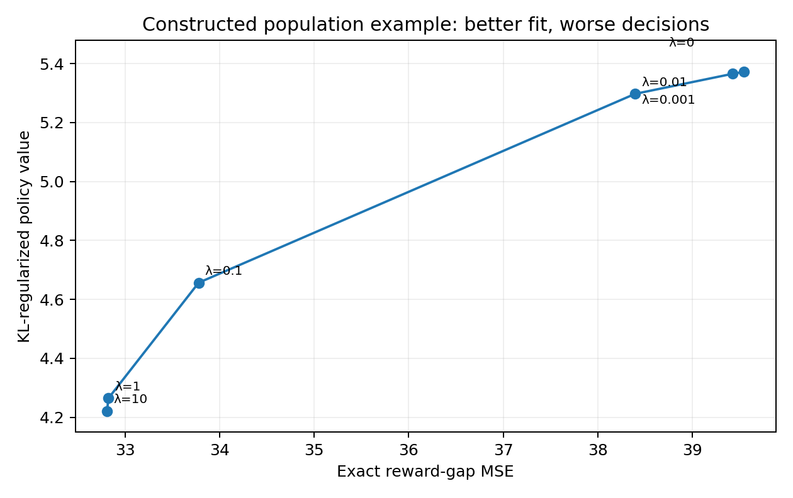
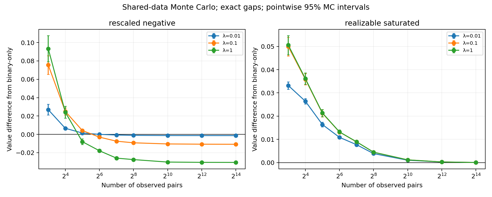

# Executed next steps: fusion theory and controlled CPU experiments

Date: 14 October 2026. Follow-up to the [proposal](proposal.md). **This report contains executed experiments and derived results, not only an experiment plan.**

## 1. Findings and updated decision

1. **The population failure extends beyond the original toy.** In a configured grid of restricted random/nonmonotone feature models, increasing exact-rating strength sometimes helps and sometimes harms. At weight 0.1, 46 of 80 restricted configurations lose value, 29 gain, and 5 change by at most the declared numerical threshold. These are correlated synthetic configurations, not an estimate of prevalence in language models.
2. **There is an observed sample-budget crossover.** With rewards $(0,3,1.2)$ and the original scalar features, rating fusion improves expected value at 32 observations but worsens it at 64 and larger sample budgets.
3. **The crossover has explicit theoretical support.** A scalar finite-action moment law identifies the structural coefficient, observation-variance coefficient and an asymptotically exact sign threshold. Reference-matched pair sampling can make the structural difference fifth order in reward scale; unmatched sampling can expose a fourth-order term.
4. **A local sampling correction is insufficient for arbitrary weight.** Frozen current-policy rating pairs initially help in the original example, but the fusion path overshoots and eventually performs worse than binary-only fitting.
5. **The obvious new-optimizer route fails its baseline test.** Reconstructing rewards from the same observed gaps, then optimizing restricted policy value, beats fusion in these controlled examples. No hidden true reward was supplied to this baseline.

**Updated recommendation:** retain a conditional comparative-theory project. Do not claim a new trust gate or optimizer. A natural language-task mechanism and a useful cost or decision advantage remain the next decisive gates. These results are stronger than the earlier proposal's scaffold, but do not establish a complete, impactful conference paper.

## Source motivation and validity limits

[RDPO, Appendix F.4](https://arxiv.org/html/2602.00603v1) reports model-dependent score-trust tuning: the chosen RDPO coefficient is 0.1 at 7B/8B scale and 0.005 for SmolLM2-1.7B, where smaller values mean greater rating trust. Its current theory leaves that behavior unresolved. This motivates a practical tuning question, but does not establish our mechanism: architecture, initialization, optimization and score quality also change. We therefore make no monotone claim that smaller models should trust ratings less.

The controlled comparison fixes deployment temperature and varies ML fusion precision. It studies policy misspecification outside the source's realizability guarantee, so it does not contradict that theorem. Exact signed gaps must be reversed with pair orientation rather than made positive after a stochastic winner bit. A finite rating weight on noiseless observations is a weighted objective, not a literal zero-variance Gaussian likelihood.

## Material Passport

| Field | Record |
|---|---|
| Mode | Local theory development, CPU simulation and result validation |
| Inputs | Supplied paper corpus, reports 04–06, saved self-review, primary-source theorem audit |
| Observation provenance | Synthetic BT bits and exact/independent Gaussian reward gaps; no human labels |
| Execution | Existing `probml` environment: Python 3.11.14, NumPy 2.4.0, SciPy 1.16.3; no package installation |
| Seed and configuration | Main seed 20261014; local-alternative seed 2026101407; configurations saved before their simulations |
| Reproducibility | Canonical source/configuration hashes, seeded experiment runners and one final table per numerical result; raw simulated draws are regenerable |
| Status | CPU experiments completed; stated model-specific theory derived; language-task and generative studies not performed |
| Review provenance | Shared-context AI-assisted workers plus root recomputation; no external independent peer review |

## 2. What was executed against the completion roadmap?

| Proposal step | Work performed | Remaining limitation |
|---|---|---|
| 1. Proof-level novelty comparison | Ten-source theorem matrix, including objective, assumptions and target | Search-bounded; no exhaustive novelty clearance |
| 2. Structural transfer theory | Scalar global path/classification, overshoot criterion, quantitative bounds; multidimensional moment and finite-weight certificates | Scalar classification requires a stated ordering condition; no general neural/global multidimensional classification |
| 3. Population and finite-sample harness | 193 population configurations, 1,158 fitted objectives; 432 Monte Carlo result rows | Chosen synthetic geometries, fixed main-sweep temperature, limited representation draws |
| 4. Statistical/projection tradeoff | Explicit estimator bias/covariance, boundary-controlled remainder, local-alternative crossover and 15 validation cells | No minimax lower bound or feedback-efficient new learner |
| 5–6. Language pilot and baselines | Matched-feedback reward-reconstruction baseline executed in the finite experiment | Natural candidate cache and frozen language features unavailable locally |
| 7. Method decision | New-optimizer claim withheld because the standard baseline succeeds | Comparative theory still requires a convincing application |
| 8–10. Main study, adapters, manuscript | Completion boundary updated | Data, usable compute and application evidence required before scaling |

## 3. Novelty audit: what is and is not available to claim

The [proof-level matrix](evidence/fusion_theorem_novelty_matrix.md) compares RDPO, AuxDPO, REBEL, Boltzmann projection, MetaPO, older ordering theory, decision-focused estimation, DIAL and classical misspecified estimation.

The mixed objective is already RDPO's ML variant. Clean projection failure, value-directed reward regression, influence weighting, sandwich covariance and generic approximation/variance crossovers are existing ideas. No identical fusion-specific path/crossover statement was located in the focused search. That absence is not proof of novelty.

The remaining candidate distinction is a **characterized nonlocal and statistical transfer law for this particular mixed observation objective under a restricted policy log-ratio class**. The results below make that candidate more concrete. Their ingredients remain largely standard. Claims about a new method, universally harmful accurate feedback or inherently necessary new labels would be incorrect.

## 4. Structural theory: a global classification rather than only a derivative

### 4.1 Exact scalar fusion path

For positive reference $\rho$, scalar features $f_i$, fixed temperature $\tau>0$, and connected weighted comparison graphs, let

$$
\pi_\theta(i)\propto\rho_i e^{\theta f_i},\qquad
\theta_\lambda=\arg\min_\theta[B(\theta)+\lambda R(\theta)].
$$

Here $B$ is the correct population BT cross entropy and $R$ is half the exact-gap squared loss. Write their unique minimizers as $\theta_B,\theta_R$, and $A=R''>0$.

**Proved:** the fusion path traverses exactly the interval from $\theta_B$ toward $\theta_R$, monotonically, visiting every interior point once. Its inverse weight map is

$$
\lambda(t)=-\frac{B'(t)}{A(t-\theta_R)}.
$$

The proof uses strict convexity, opposite derivative signs at the endpoints, and the population first-order equation. It also shows that rating error decreases and binary CE increases along a nonconstant path. Neither determines the value direction.

### 4.2 When endpoint information is sufficient

Define each action-pair reward slope and feature sum:

$$
a_{ij}=\frac{r_i-r_j}{f_i-f_j},\qquad u_{ij}=f_i+f_j.
$$

Under the explicit condition that slopes are nonincreasing as feature sums increase, the covariance ratio

$$
k(\theta)=\frac{\operatorname{Cov}_{\pi_\theta}(f,r)}{\operatorname{Var}_{\pi_\theta}(f)}
$$

is nonincreasing. Therefore $J'(\theta)=\operatorname{Var}_{\pi_\theta}(f)[k(\theta)-\tau\theta]$ changes sign exactly once, at the unique global value maximum $\theta_*$.

**Consequences under this ordering condition:**

- Every finite nonnegative fusion weight is noninferior to the binary endpoint if and only if $J(\theta_R)\ge J(\theta_B)$.
- Moving away from the value maximum gives strict harm for every positive weight.
- Moving toward it without passing it gives monotone improvement.
- Passing it yields an overshoot: value first increases and then decreases. If the rating endpoint is below the baseline, there is exactly one finite return to baseline value.

The ordering assumption is substantive and restrictive. Without it, the exact interval path remains true, but endpoint value alone need not classify all intermediate policies. A scalar endpoint theorem does not automatically extend to a curved multidimensional path.

### 4.3 Frozen on-policy ratings: a useful correction that can overshoot

For the original rewards $(0,10,4)$ and features $(0,0.7,1)$, freeze rating pairs at $\pi_B\otimes\pi_B$. The binary loss uses the mean over three unordered distinct edges; the rating loss uses the unconditioned ordered-pair law, including zero-contribution self-pairs. **These normalizations define the following weight units.**

| Quantity | Computed value |
|---|---:|
| Binary parameter | 2.246254480 |
| True restricted value-optimal parameter | 1.641408577 |
| Frozen on-policy rating-only parameter | −0.656093466 |
| Weight at peak value | 0.135295213 |
| Weight at return to binary value | 0.378069786 |
| Binary endpoint value | 5.371937162 |
| Rating-only endpoint value | 3.862927743 |

**Intuition:** weighting pairs toward current decisions fixes the initial direction, but deeply fitting a frozen quadratic target can carry the model past the useful policy. This is not a criticism of iterative REBEL or of recomputing the policy/sampling law; those are different procedures.

The complete [structural proofs](evidence/fusion_structural_theorems.md) also include a multidimensional residual-moment path identity, a centered distribution-mismatch bound, value curvature and a finite-weight remainder. They provide finite-action certificates, not a practical estimator with unknown rewards. [Checks and results](verification/fusion_structural_checks.py).

## 5. Statistical theory: explicit coefficients and an actual crossover

### 5.1 Estimator bias matters

For one iid pair, let $\psi$ be the mixed-loss derivative at its population optimizer, and define

$$
H=\mathbb E\psi',\qquad T=\mathbb E\psi'',\qquad
C=\mathbb E\psi^2,\qquad D=\mathbb E(\psi\psi').
$$

With the stated compact-region, interior-margin, curvature and noise assumptions, the scalar estimator has

$$
b_\lambda=\frac D{H^2}-\frac{TC}{2H^3},\qquad
\mathbb E\mathcal E(\widehat\theta_\lambda)
=A_\lambda+\frac{V_\lambda}{n}+O(n^{-3/2}),
$$

$$
V_\lambda=-J'(\theta_\lambda)b_\lambda
-\frac12J''(\theta_\lambda)\frac C{H^2}.
$$

The full [statistical derivation](evidence/fusion_statistical_theory.md) supplies explicit moment formulas, conservative uniform remainder constants and exponentially controlled boundary terms. It treats Gaussian gaps as unbounded observations and retains random-design covariance and correlated-channel terms where applicable. Expected signed $1/n$ corrections do not imply a high-probability $1/n$ value bound at a nonstationary surrogate optimum.

### 5.2 General scalar moment law

For clarity set $\tau=1$ here; the full note gives arbitrary fixed temperature. Take any finite action set with distinct scalar features, full-support reference $\rho$, reward direction $h$ and rewards $r=\epsilon h$. Sample two independent reference actions, conditioned on being distinct. Define $d=f_i-f_j$, $g=h_i-h_j$, and

$$
\mu_2=\mathbb E_qd^2,\quad \mu_4=\mathbb E_qd^4,\quad
k=\frac{\mathbb E_q(dg)}{\mu_2},\quad
b_3=\frac{\mu_4k^3-\mathbb E_q(dg^3)}{12\mu_2},
$$

$$
c_2=k\kappa_\rho(f,f,h)-k^2\kappa_\rho(f,f,f).
$$

Here the third cumulants are centered third cross moments. The population roots satisfy

$$
\theta_B=\epsilon k+\epsilon^3b_3+O(\epsilon^5),\qquad
\theta_\lambda=\epsilon k+\frac{\epsilon^3b_3}{1+4\lambda}+O(\epsilon^5).
$$

Their deployment-regret difference is characterized, rather than left as an unknown approximation constant:

$$
A_\lambda-A_0=P_\lambda\epsilon^5+O(\epsilon^6),\qquad
P_\lambda=c_2b_3\frac{4\lambda}{1+4\lambda}.
$$

For conditionally independent Gaussian gap noise of constant variance $v$, the leading statistical coefficients are

$$
V_0\to\frac{2\operatorname{Var}_\rho f}{\mu_2},\qquad
V_\lambda\to\frac{\operatorname{Var}_\rho f}{2\mu_2}
\frac{1/4+\lambda^2v}{(1/4+\lambda)^2}.
$$

The statistical advantage $W=V_0-V_\lambda$ is positive exactly when $v<4+2/\lambda$. If $P_\lambda>0$ and $W>0$, then for any sequence $n\epsilon^5\to t\in(0,\infty)$,

$$
\epsilon^{-5}\left[\mathbb E\mathcal E(\widehat\theta_\lambda)
-\mathbb E\mathcal E(\widehat\theta_B)\right]
\longrightarrow P_\lambda-\frac Wt.
$$

Thus budgets below $t_*=W/P_\lambda$ favor fusion and budgets above it favor binary-only fitting for sufficiently small reward scale. This is a comparative-estimator limit theorem. It does not assert a unique finite-$n$ crossing, settle equality at the threshold, or establish a minimax information limit.

**Why fifth order?** Both fitting objectives agree at first order in weak rewards. Their parameters separate at cubic order, while the deployment gradient at that fitted point begins at quadratic order under reference-matched sampling. Multiplying those discrepancies yields the fifth-order value difference.

For an unmatched pair design, $c_1=\operatorname{Cov}_\rho(f,h)-k\operatorname{Var}_\rho f$ need not vanish. The structural difference can then start at fourth order, and the analogous crossover scale becomes $n\epsilon^4$. Pair sampling is therefore part of the theorem, not an interchangeable implementation detail.

### 5.3 Explicit nonempty family and independent checks

For $f=(0,0.7,1)$, $h=(0,1,0.4)$, uniform reference/pairs, exact gaps and $\lambda=0.1$,

$$
P_{0.1}=0.00012673156700238956,\qquad
W=\frac23-\frac{50}{147},\qquad
t_*=2576.5531032906833.
$$

Root independently checked the general moment law using exact Fraction coefficients, 70-digit Decimal policy roots/value, three matched/unmatched three-/four-action cases and 15 shrinking-scale evaluations. The fourth-order unmatched case has a different sign. [Independent check code](verification/check_fusion_moment_law.py), [results](verification/fusion_moment_law_checks_results.json).

The numerical local-alternative experiment used $\epsilon=0.2,0.4,0.8$, five budget factors around $t_*/\epsilon^5$, and 4,096 paired draws per cell. Every prescribed cell is retained. All scales show benefit at factors 0.25 and 0.5, harm at factors 2 and 4. The factor-1 intervals contain zero at scales 0.2 and 0.4; scale 0.8 remains beneficial there, illustrating finite-scale error rather than an exact finite-$\epsilon$ threshold.

No compact-boundary hits occurred in these 61,440 paired draws. [Configuration](verification/fusion_local_alternatives_config.json), [all cell statistics](verification/fusion_local_alternatives_results.csv), The seeded runner regenerates all paired draws; the cell CSV is the canonical stored result.

**Practical limitation:** the local effect is very small: at scale 0.2, several differences are around $10^{-8}$. This establishes an asymptotic mechanism, not an economically meaningful deployment improvement.

## 6. Executed population grid

The [configuration](verification/fusion_experiment_config.json) was saved before the sweep. Action counts were 3, 8 and 32; feature ranks were one, up to three, and full identifiable rank. References were uniform or tilted; pair sources were uniform or reference-based; reward ranges were 2 and 10; reward patterns were random, nonmonotone or explicitly realizable. The main sweep held temperature at one.

The 193 configurations include the original example, 72 full-rank configurations and 64 declared-realizable configurations; these groups overlap. There are 80 restricted random/nonmonotone configurations used in the following descriptive counts. Nested ranks share one feature-basis draw per action count, and some design choices coincide at a uniform reference. **The 80 configurations are not 80 independent population samples.**

| Exact-rating weight | Lower value | Higher value | Change within $10^{-6}$ |
|---:|---:|---:|---:|
| 0.001 | 38 | 36 | 6 |
| 0.01 | 39 | 36 | 5 |
| 0.1 | 46 | 29 | 5 |
| 1 | 48 | 28 | 4 |
| 10 | 50 | 27 | 3 |

All 1,158 population fits converged with maximum gradient infinity norm below $9.90\times10^{-10}$. Declared realizable controls had value differences below $10^{-6}$. Seventy-six configurations had an appreciable local derivative; all had matching small-weight finite-difference signs. That last result validates the local identity numerically; it does not turn an oracle residual diagnostic into a practical predictor.



[Full population CSV](verification/fusion_sprint1/population.csv), [run manifest](verification/fusion_sprint1/run_manifest.json).

## 7. Executed finite-sample crossover

Four prespecified scalar cases, nine sample budgets, two noise levels and six weights produced 432 result rows. Each row uses 1,024 draws; weights share the same observations. There are 72 independent dataset-generation conditions, not 432 independent datasets.

For the moderate misspecified case $r=(0,3,1.2)$ and exact gaps, the following comparisons use $\lambda=0.1$. Positive value difference favors fusion.

| Observed pairs | Mean value difference from binary-only | Pointwise 95% Monte Carlo interval |
|---:|---:|---:|
| 8 | +0.075541 | [+0.065354, +0.085727] |
| 32 | +0.004134 | [+0.002463, +0.005805] |
| 64 | −0.003037 | [−0.003875, −0.002198] |
| 128 | −0.007445 | [−0.007878, −0.007013] |
| 16,384 | −0.010810 | [−0.010835, −0.010786] |

At this fixed reward scale, the actual population penalty is $0.010850427$ and the computed difference in expected-risk coefficients is approximately $-0.469787811$. Their large-sample approximation suggests a crossing near 43 observations. The observed sign changes between 32 and 64 are consistent with that approximation; the conservative theorem remainder does not certify that particular finite-$n$ threshold.

The original high-reward-range example remains harmful at the sampled budgets. Realizable controls benefit statistically and have no population fusion penalty. Saturated realizable binary fits frequently hit the compact boundary at tiny sample sizes, so their small-$n$ gains cannot be interpreted through an interior asymptotic expansion. The moderate crossover has no boundary hits at 32, 64 or 128 observations in this run.



[All finite-sample rows](verification/fusion_sprint1/finite_sample.csv), [coefficient table](verification/fusion_sprint1/asymptotic_coefficients.csv).

## 8. Matched-feedback baseline: the new-optimizer premise fails here

The follow-up control reconstructs rewards by weighted least squares on the observed gap graph, with action zero anchored. It then optimizes the same fixed-reference policy value over the same parameter interval. Disconnected graphs use a declared minimum-norm imputation and are reported. This baseline receives the observed gaps, **not the true reward table**; true rewards are used only for evaluation.

Synthetic observations were regenerated from the recorded seed. All 432 original paired comparison means reproduced exactly before the baseline comparison. On connected exact-gap graphs, reconstructed rewards differed from truth up to the anchor by at most $1.78\times10^{-15}$.

| Case, exact gaps | Pairs | Reconstruction value minus fusion value, weight 0.1 |
|---|---:|---:|
| Original misspecified example | 32 | +0.784918 |
| Original misspecified example | 16,384 | +0.781310 |
| Moderate crossover example | 32 | +0.035579 |
| Moderate crossover example | 16,384 | +0.020735 |

All graphs in these selected cells were connected. With Gaussian gap noise of standard deviation one, the moderate case at 128 pairs still favors reconstruction by $0.024873$, with Monte Carlo interval $[0.023682,0.026065]$.

**Interpretation:** the experiment demonstrates that a particular use of additional information can be poor. It does not show that accurate information itself has negative value, or that a new feedback channel is required. This existing reward-estimation/value-optimization baseline defeats the proposed simple corrective method in the small finite benchmark. It does not automatically settle a large language-model optimization or cost comparison.

[Baseline configuration](verification/fusion_baseline_config.json), [code](verification/run_fusion_baseline_audit.py), [all comparisons](verification/fusion_sprint1/reconstruction_baseline.csv), [verification receipt](verification/fusion_sprint1/run_manifest.json).

## 9. Statistical interpretation and integrity checks

**11/11 statistical/methodological fallacy categories checked.**

| Category | Disposition |
|---|---|
| Simpson's paradox | Cases/noise/weights retained separately; pooled harm counts describe only the configured grid |
| Ecological fallacy | No inference from synthetic configurations to individual prompts or model families |
| Berkson/selection bias | Chosen feature/reward grid disclosed; no estimate of real-task prevalence |
| Collider bias | No post-outcome control conditioning used |
| Base-rate neglect | Local sign agreement is algebraic verification, not an estimated deployment classifier accuracy |
| Regression to the mean | Paired algorithm comparisons use shared simulated observations, not selected pre/post extremes |
| Survivorship bias | All configured cases/weights retained; convergence and boundary events reported |
| Look-elsewhere effect | All rows saved; displayed intervals are descriptive pointwise MC uncertainty, no adjusted discovery claim |
| Forking paths | Initial configuration saved before execution; baseline audit is explicitly a follow-up; denominator correction disclosed in the manifest |
| Causal overreach | Intervention conclusions apply to the synthetic generator; language-model mechanism remains untested |
| Reverse causality | Synthetic data law fixed before fitting; no observational causal-direction claim |

MC intervals quantify error in estimating an expectation under the declared simulator. They are not confidence intervals over human preference, task populations or independent language-model training runs. Near the local-alternative threshold, very small effects warrant interpretation through the theorem and full intervals, not a binary significance label.

## 10. What remains available, and what is blocked?

The local CPU environment is sufficient for finite-action theory, simulation and a response-selector pilot once its data exist. Shell DNS fails for public dataset/model hosts, the browser inventory is empty, and the local Hugging Face cache has only a model reference pointer, not usable model weights. GPU queries fail and PyTorch reports CUDA unavailable.

Consequently no verified natural-language candidate cache, executable-check dataset or frozen embeddings were available to run E2. No model generations or adapter training were fabricated. GPU access is not inherently required for a selector, but it is an additional prerequisite for the proposed generative study at reasonable scale.

### Required next actions after this sprint

1. **Obtain a natural scored candidate cache and frozen features.** Pin prompt splits, candidate generator, decoding, reference, check definitions and feature provenance. A public cache with executable checks can support a CPU selector pilot without new paid generation.
2. **Run the representation intervention.** Same candidates/rewards/reference/temperature; change only a nested feature/bottleneck subspace. Test whether the theory predicts adverse and favorable cases outside synthetic features.
3. **Benchmark the ordinary repairs.** Include separate reward estimation/direct value optimization and REBEL-style updates with matched feedback, search and rollout costs. Add AuxDPO and validation weighting when implementations can be matched.
4. **Strengthen the distinctive theorem if the application survives.** A general multidimensional phase law, sharp nonlocal classification or meaningful finite-budget comparison would strengthen the paper. The current results do not provide minimax lower bounds or a useful new learner.
5. **Scale only after a practical decision changes.** If ordinary repairs are equally cheap and the only novel result is a very small local-asymptotic effect, demote the project rather than funding a large adapter sweep.

## 11. Reproduce the completed work

From the workspace:

```bash
python3 studies/ranking_rating_fusion/verification/fusion_structural_checks.py
python3 studies/ranking_rating_fusion/verification/check_fusion_moment_law.py
/home/levantuananh/anaconda3/envs/probml/bin/python studies/ranking_rating_fusion/verification/run_fusion_experiments.py
/home/levantuananh/anaconda3/envs/probml/bin/python studies/ranking_rating_fusion/verification/run_fusion_baseline_audit.py
/home/levantuananh/anaconda3/envs/probml/bin/python studies/ranking_rating_fusion/verification/fusion_local_alternatives.py
python3 scripts/validate_reports.py
```

The first commands require only standard-library Python; the experiment commands use the existing numerical environment. They write local results and require no network. Figures are stored once as PNG images. Formula syntax and local links are checked by the shared validator, which uses temporary build files and generates no HTML. Those checks do not establish novelty or mathematical correctness.
