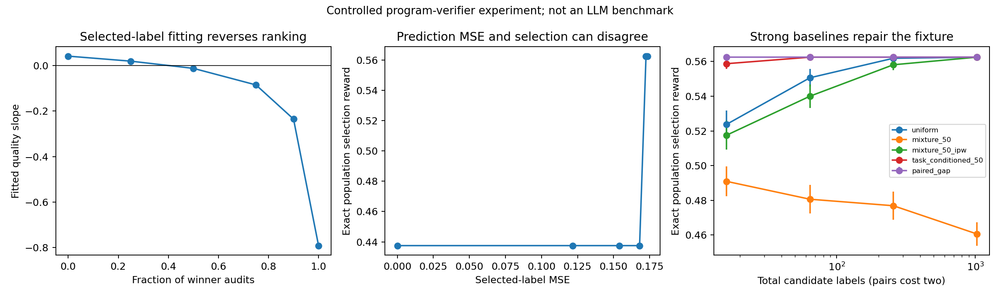

# When do verifier audits fail to transfer across problems?

**Evidence reviewed: 14 October 2026.**

**Decision updated, 15 October 2026:** rejected as an active paper direction. Standard baselines solve the constructed failure, and no remaining failure on a real verifier has been established. The conditional proposal below is retained as historical analysis, not a recommendation to pursue it.

## 1. Research question and practical value

> Under a fixed execution budget, why can fitting a shared verifier to its selected code candidates improve prediction error yet fail to improve candidate selection on unseen problems? When should execution labels be spent on additional problems versus contrasting candidates within one problem?

A code-generation pipeline can generate candidates cheaply relative to exhaustive testing, use a learned verifier to select one, and execute a small subset to update that verifier. The decision is how to acquire and use those execution labels. Improving the verifier on the audited subset is useful only if the updated verifier selects better code at deployment.

The intended use cases are code reranking, execution-budget allocation during verifier training, and reward-model maintenance during code RL. The immediate output would be an evidence-based choice among established audit and fitting recipes. A new algorithm is justified only if those recipes leave a reproducible failure.

This differs from the [earlier ranking/rating fusion study](../ranking_rating_fusion/research_report.md): the object is acquisition and transfer of a shared correctness verifier, using execution outcomes, rather than combining two forms of feedback in a DPO objective.

### Evidence that the question exists

[Proof-Carrying Cognition (PCC), September 2026, §§8–8.1](https://arxiv.org/html/2609.09776v1) reports that its roughly tenfold on-policy labeling advantage in synthetic per-task settings failed on real code. Its unequal-budget comparison gives AUC 0.144 at 240 selected labels versus 0.170 at 720 random labels. Separately, an equal-budget mixture obtained 0.148 versus 0.147 for selected-only and 0.170 for random. Its competence and mixture interventions failed to explain the discrepancy, and the authors identify cross-problem transfer as an open question. These are reported results, not our replication. They establish inferior audit efficiency in that setting; they do not by themselves establish absolute deterioration from the frozen verifier or eliminate every coverage/capacity explanation.

[Aletheia, 2026, §3.2/Table 4 and §4](https://arxiv.org/html/2601.12186v4) independently makes the pipeline relevance concrete: the benefit of on-policy verifier training depends on model size and evaluation shift. At 7–14B, it reports little top-1 benefit on easy-to-hard generalization; its cost comparison also favors some offline recipes. This motivates a conditional operating-regime study, not a claim that on-policy training is generally ineffective. Its online/offline recipe ablations are already contributions of that paper.

**Our hypothesis, not a source-established explanation:** an audit changes how a misspecified shared head fits task difficulty and candidate quality. Absolute correctness differs across tasks; selecting a candidate depends on relative quality within its task. Selected-only labels can entangle the two.

## 2. Renewed literature screen and intuition

The existing [26-paper corpus audit](../../reports/dpo_expanded/01_expanded_literature_analysis.md) supplied the starting map. This pass freshly revisited the relevant ProFit, generalization, coverage, DuPO, F-DPO, P²-DPO and MISP material and searched primary sources for the closest repairs. It was a focused research-question screen, not a new claim that all 26 full texts were reread. Native workers performed bounded source screens and criticism; these were agents sharing this session, not external independent peer reviewers.

| Paper / primary source | Intuition: what it actually does | Deep insight for this decision | Disposition |
|---|---|---|---|
| [ProFit v3](https://arxiv.org/abs/2601.09195v3), §§4–6 | Skip teacher tokens the learner considers too unlikely. | A probability threshold can omit unfamiliar knowledge, but shared updates can later activate omitted tokens. A direct zero gradient is not a lifelong impossibility theorem. | Do not propose generic novelty-aware token retention. |
| [InfoSFT](https://arxiv.org/html/2605.14967v1), §§2–4 | Give middle-confidence tokens more weight under a distribution-shift budget. | It explicitly discusses suppressed novel behaviors and bootstraps an unfamiliar format with SFT before reweighting. | Generic support bootstrapping is occupied. |
| [MixSD](https://arxiv.org/html/2605.16865v2), §3 | Combine knowledgeable context with the student's familiar distribution. | It already studies new-fact acquisition and retention. | Reject a generic new-fact/retention proposal. |
| [DuPO](https://proceedings.iclr.cc/paper_files/paper/2026/hash/332aa4b65f636f7187982ae5bb16e50a-Abstract-Conference.html), conditional dual task | Test whether an answer can reconstruct a missing part of the question. | Consistency, information sufficiency and truth are separate; matching forward/inverse errors can remain consistent. | Useful motivation; generic verifier-soundness work is crowded. |
| [Verifier Errors in RLVR](https://arxiv.org/abs/2609.35677), September 2026 | Use additional correctness audits to counter accepted errors. | Feedback-only impossibility and audit-based selective control are already studied. | Reject “add audits to stop reward hacking” as novelty. |
| [MISP-DPO](https://arxiv.org/abs/2509.25717), §4/Algorithm 1/App. A.3–A.5 | Train against several distinct wrong images for a fixed answer. | Deterministic slate selection and iid importance estimation have different guarantees; three negatives beat five in one reported ablation. | A sampled-normalizer correction alone collides with existing statistics. |
| [SymMPO](https://arxiv.org/html/2506.11712v3), §4 | Obtain valid answers for both images and compare answers within each image. | Richer supervision repairs the cross-image conditioning problem; counterpart-answer construction has a cost. | Mandatory baseline for any visual-supervision proposal. |
| [IC-VCO](https://arxiv.org/html/2605.31312v1), §§2–3 | Put two images in a common context, compare answers there, and distill to a single-image branch. | It already addresses uncancelled image normalizers and the resulting context gap. | Reject a missing-normalizer fix as new. |
| [Statistical ranking with dynamic covariates](https://arxiv.org/html/2406.16507v3), §3 | Separate item effects from features that vary between comparisons. | Incidence-rank and cycle conditions already characterize identifiable feature directions. | A graph/Fisher identification lemma alone is insufficient. |
| [Active Learning for Misspecified Models](https://www.ms.k.u-tokyo.ac.jp/sugi/2005/NIPS2005a.pdf), §§3–4 | Correct the target change caused by choosing where to collect labels. | Query-induced projection bias and importance-weighted regression are established. | Strongest objection to a generic audit-bias method. |
| [NAOD](https://arxiv.org/html/2609.38860v1), §§3–5/App. B | Choose comparisons using information about the desired policy after accounting for judge nuisance. | Nuisance-adjusted information, discrepancy exposure and policy-risk weighting are already covered. | Generic nuisance-aware acquisition is occupied. |
| [Best-of-N optimality, COLT 2026](https://proceedings.mlr.press/v336/sriraman26a.html) | Analyze response selection using a pairwise win-rate target and guard against hacking. | An analysis must specify its utility; squared prediction error is not the only meaningful objective. | “Calibration differs from ranking” is not a contribution by itself. |
| [Iterative RLHF/FPO](https://arxiv.org/html/2605.04266v1), §§2–5 | Account for how policy behavior changes future reward-model fitting. | Coupled reward-model feedback already has an explicit theoretical literature. | A refitting cycle alone is not new. |
| [Aletheia](https://arxiv.org/html/2601.12186v4) | Compare verifier recipes on execution-grounded code and several shifts. | Recipe value changes with scale and deployment role. | Public benchmark and essential empirical comparator. |

### Alternatives rejected in this pass

1. **Unfamiliar-token learning:** real concern, but InfoSFT, MixSD and related compatibility methods already address the broad proposal. A threshold counterexample would be too small a contribution.
2. **Verifier reliability / selected-tail auditing:** generic correctness-audit control is already established. A more specific, documented transfer failure is needed.
3. **Cross-image DPO:** the basic normalization issue and richer-answer repairs exist. There remains a possible annotation-cost question, but ordinary reward-graph reconstruction and experimental design must first be beaten. No novelty-cleared new visual method emerged.

The auditing-transfer question is selected because it has a reported failed empirical bridge and a practical budget decision. This is a reason to investigate it, not evidence of a new theorem or guaranteed acceptance.

## 3. Formal setup: what has to improve?

Let $x$ be a problem and $y$ a candidate program. Its expected executed correctness is $g(x,y)\in[0,1]$. A shared verifier scores it with $s_\theta(x,y)$. A bank contains $N$ candidates sampled from $P(\cdot\mid x)$.

The deployment objective is

$$
U_N(\theta)=\mathbb E_{x,y_{1:N}}\left[g\left(x,y_{\hat j}\right)\right],
\qquad \hat j=\arg\max_{j\le N}s_\theta(x,y_j).
$$

Auditing policy $Q$ determines which programs receive trusted execution labels $G$. A common fitting objective is

$$
\theta_Q=\arg\min_\theta\mathbb E_Q[(s_\theta(X,Y)-G)^2].
$$

There are three separate outcomes to measure: gain over a frozen verifier, gain over equal-budget random auditing, and an actual decrease from the frozen verifier. They must not be combined into one claim.

### Why task difficulty matters

Suppose

$$
g(x,y)=b(x)+\theta_*^\top\phi(x,y).
$$

Here $b(x)$ is candidate-independent task difficulty. It cancels from within-problem ranking. An absolute-score head that cannot represent $b(x)$ may nevertheless use candidate features to approximate it. Acquisition changes the feature/difficulty covariance and therefore the fitted slope. Accurate labels do not prevent this projection error.

Adding the specification, appropriate problem–code interactions, or sufficient head capacity could remove the issue. That is an explanation to test first. Subtracting a problem constant only at inference cannot change rankings and is not a repair.

## 4. Necessary theory, with proofs and novelty limits

These are scoped diagnostic results derived for this pilot. Their ingredients are standard regression, identification and concentration. They are not claimed as a publishable new theorem package.

### Result 1: a computable reversal boundary

Let task type $T$ be equally likely $+1$ or $-1$. Candidate proxy feature $Z$ is $\{-2,2\}$ for type $+1$ and $\{-1,1\}$ for type $-1$. For nuisance amplitude $A\ge0$, define

$$
g_A(T,Z)=\frac{Z-AT+A+2}{2A+4}.
$$

The frozen score $s_0(Z)=0.5+0.1Z$ ranks candidates correctly on every task. A label is acquired uniformly with probability $1-\rho$ and from the frozen winner with probability $\rho$. Both task types retain equal coverage. Refit an affine score $a+bZ$ to exact labels.

**Claim.** Its population slope is

$$
b_\rho=\frac{1}{2A+4}
\left(1-\frac{A\rho/2}{2.5-2.25\rho^2}\right).
$$

**Proof.** Under acquisition, $\mathbb E Z=1.5\rho$, $\mathbb E Z^2=2.5$, $\mathbb E T=0$ and $\mathbb E TZ=0.5\rho$. Thus $\operatorname{Var}(Z)=2.5-2.25\rho^2$ and $\operatorname{Cov}(Z,T)=0.5\rho$. Least squares gives $b=\operatorname{Cov}(Z,g_A)/\operatorname{Var}(Z)$, yielding the expression. The variance is positive throughout $[0,1]$.

For $A=10$, ranking reverses when

$$
\rho>\rho_c=
\frac{-A/2+\sqrt{A^2/4+22.5}}{4.5}
=0.4204498613.
$$

At $\rho=1$, the refitted head exactly fits both acquired winner labels, yet reverses both rankings. Clipping its predictions to $[0,1]$ still leaves the unobserved losers above the observed winners in this example. A half-random mixture also reverses the population ranking.

**What this establishes:** task coverage and trusted labels alone do not guarantee safe refitting. **What it does not establish:** the mechanism occurred in PCC, or a stronger representation would fail. Known-propensity importance weighting repairs this population example for every $\rho<1$.

### Result 2: winner-only labels can lack the relevant information

Consider $g(x,y)=b_x+\theta^\top\phi(x,y)$ with unrestricted task offsets. If only one fixed candidate $y_x$ is audited on each task, then every alternative $\theta'$ can reproduce the observations using

$$
b_x'=b_x+(\theta-\theta')^\top\phi(x,y_x).
$$

Consequently, more repeats of those same candidates do not identify candidate contrasts. For two actions with features $-1,+1$, suppose the audited $+1$ action has correctness $1/2$. The worlds

$$
\theta=\eta,\ b=1/2-\eta
\quad\text{and}\quad
\theta=-\eta,\ b=1/2+\eta,
\qquad 0<\eta\le1/4,
$$

have identical audited outcomes but opposite optimal actions. Any randomized decision has worst-world regret at least $\eta$. This follows because its two regrets are $2\eta p$ and $2\eta(1-p)$ for an appropriate action probability $p$.

One additional candidate label on the same problem distinguishes the worlds. This is a standard identification argument. It applies to the stated unrestricted-offset contract; task structure, prior restrictions or additional observations can invalidate its premise.

### Result 3: contrasts remove task nuisance, but only under shared gap structure

Audit two candidates on a problem, paying for both labels. Let

$$
D_i=\phi(x_i,y_i^+)-\phi(x_i,y_i^-),
\qquad \Delta G_i=G_i^+-G_i^-.
$$

Under the additive model and unbiased independent audit errors,

$$
\Delta G_i=D_i^\top\theta_*+\varepsilon_i^+-\varepsilon_i^-.
$$

The task offset cancels exactly. With $n$ independent pairs, design matrix $D$, and Gaussian label noise of variance $\sigma^2$ per candidate,

$$
\widehat\theta=(D^\top D)^{-1}D^\top\Delta G,
\qquad
\operatorname{Cov}(\widehat\theta\mid D)
=2\sigma^2(D^\top D)^{-1}.
$$

If $\lambda_{\min}(D^\top D)\ge n\kappa$, test feature differences have norm at most $L$, and each best-versus-competitor gap is at least $\Delta>0$, then for a test slate of $N$ candidates,

$$
\Pr(\text{wrong selection}\mid D)
\le\min\left\{1,(N-1)
\exp\left(-\frac{n\kappa\Delta^2}{4\sigma^2L^2}\right)\right\}.
$$

**Proof.** Each estimated gap error is Gaussian with variance at most $2\sigma^2L^2/(n\kappa)$. A one-sided Gaussian tail bound gives the exponential term; a union bound over competitors gives $N-1$. With $g\in[0,1]$, expected selection regret is also bounded by this probability. Since $B=2n$ candidate labels, the exponent is $-B\kappa\Delta^2/(8\sigma^2L^2)$.

Independent sub-Gaussian audit errors give the same form with their variance proxy. An average of $m$ independently sampled binary test outcomes has proxy $1/(4m)$; this explains why the partial-test pilot has nonzero measurement noise.

**Limits.** The result requires correctly shared linear gap structure, independent pairs, full-rank contrasts and a positive margin. Arbitrary nonlinear residuals, correlated errors or task-specific slopes are not repaired merely by differencing. The formula does not compare optimally designed pointwise audits to pairs. That comparison remains necessary; the bound itself is established linear-model reasoning.

### Result 4: the information needed for selection is invariant to offsets

For a finite slate, let

$$
\delta_x=\inf_c\max_{j\le N}|s(x,y_j)-g(x,y_j)-c|.
$$

The selected candidate's regret is at most $2\delta_x$: compare its score with the true best score and apply the two approximation errors. A task-only shift contributes zero to this discrepancy even if it is large in absolute prediction MSE.

For a smooth selector $p_j\propto\exp(s_j/\tau)$, its expected gold reward $V=\sum_jp_jg_j$ satisfies

$$
\frac{dV}{d\alpha}\bigg|_{\alpha=0}
=\frac1\tau\sum_jp_j(g_j-V)d_j,
\qquad s_j(\alpha)=s_j+\alpha d_j.
$$

This derivative vanishes for a common score shift. It was checked against finite differences for slate sizes 2, 4 and 16. It is a standard softmax identity, not evidence that the pilot addresses realistic large-$N$ selection.

### Result 5: ordinary importance correction is a decisive baseline

For positive known propensity, let $w=dP/dQ$. Then

$$
\mathbb E_Q[w(s_\theta-G)^2]
=\mathbb E_P[(s_\theta-G)^2].
$$

In the four-state fixture, the weights are $1/(1+\rho)$ on winners and $1/(1-\rho)$ on losers. Thus population weighted fitting restores the uniform projection for $\rho<1$. At $\rho=1$, missing loser support makes this correction unavailable. Large weights near one also create finite-budget variability, but a variance penalty is not proof that pairing beats every optimal design.

This established correction is why the present example cannot justify a new acquisition method. The proposed research must compare against it instead of presenting projection bias as an unaddressed issue.

### Result 6: adaptive auditing changes the one-step conclusion

The acquisition policy above selects from the frozen verifier. In an actual audit loop, selection changes after refitting. Let $e\in\{-1,1\}$ denote the current weak head's ranking direction. Under current-winner mixture fraction $\rho$, the next population slope is

$$
b_{\mathrm{next}}(e)=\frac{1}{2A+4}
\left(1-\frac{Ae\rho/2}{2.5-2.25\rho^2}\right).
$$

This follows by replacing the signed selection bias $\rho$ in Result 1 with $e\rho$. If $A\rho/2>2.5-2.25\rho^2$, a positive head becomes negative; a negative head becomes positive. Refitting only the latest population window therefore yields a deterministic two-cycle, rather than permanent one-direction collapse. For $A=10$, its average selected correctness over an even number of rounds is 0.5, below the frozen value 0.5625. Fitting accumulated labels instead changes that trajectory.

This sensitivity analysis is necessary before interpreting one-step harm as a long-run pipeline failure. The mathematical statement uses a fixed candidate law and exact unregularized population fits. The numerical check uses negligible ridge regularization as specified below. It is neither an LLM RL simulation nor a new general theorem about adaptive reward models.

## 5. Experiments actually performed

### Design and provenance

The [runner](run_experiments.py) executed **640 generated program instantiations, representing 360 distinct Python source strings, and 7,040 deterministic unit-test calls**. Each task specifies an affine arithmetic function and a finite input domain. Candidates corrupt a subset of that domain. The resulting executed pass fractions exactly equal $g_A(T,Z)$ above; the maximum label-identity discrepancy was zero.

The feature $Z$ is a deliberately supplied quality proxy, and task type $T$ is deliberately omitted from the weak head. This is a controlled construction, not an embedding extracted from a pretrained code verifier. The richer head receives $T$. Unseen task IDs change arithmetic specifications but retain the same four-state feature/reward law. Finite-budget fitting samples that equivalent law and evaluates its exact population. **This is not a meaningful estimate of semantic generalization to new coding problems.** Executability checks the labels; it does not make the task realistic.

We then ran **432 finite-budget configurations, 200 repetitions each: 86,400 fitted heads**. A further 112 static population rows, 576 adaptive population rounds and three derivative checks produce 1,123 aggregate rows in the [single result file](results.csv). Adaptive rounds comprise 24 population configurations with 24 refits each; they are not additional finite-budget trials.

Factors:

- Task-nuisance amplitude: 0, 1, 3, 10.
- Candidate-label budget: 16, 64, 256, 1,024.
- Tests per audited candidate: 2, 8, or the full finite test suite.
- Acquisition/fitting: uniform; winners; 50% and 90% winner mixtures; both mixtures with known-propensity weighting; task-conditioned fitting; paired gap fitting; and a monotonicity guard that preserves the known-good proxy order.

Pairs consume two candidate labels. Under partial auditing, each label consumes the same number of sampled tests. Full-suite costs are also matched within each nuisance setting. Repetitions use common random inputs across methods. The reported uncertainty is Monte Carlo standard error across fits, not benchmark or training-seed uncertainty for an LLM.

Cached execution outcomes drive the finite-budget trials: the manifest distinguishes the actual 7,040 executed tests from modeled audit budgets. We did not execute billions of new tests or run 86,400 code-generation models.

The cache stores the four equivalent execution-outcome arrays for each nuisance setting; partial audits draw test inputs independently **with replacement**. Numerical regression uses ridge $10^{-10}$ for stability; displayed OLS results refer to this numerical approximation, whereas Result 3's covariance is the unregularized theoretical formula. Population expectations are computed exactly on the four states, followed by numerical linear solves. The paired head estimates its absolute intercept from the same audited labels; its selection results are independent of that intercept. Absolute-MSE comparisons are not used to claim its superiority.

### Population results: nuisance amplitude 10

| Winner-audit fraction | Fitted slope | Acquisition-distribution MSE | Selection reward |
|---:|---:|---:|---:|
| 0 | 0.041667 | 0.173611 | 0.562500 |
| 0.25 | 0.019592 | 0.172461 | 0.562500 |
| 0.50 | −0.012097 | 0.168011 | 0.437500 |
| 0.75 | −0.084916 | 0.153833 | 0.437500 |
| 0.90 | −0.235086 | 0.121720 | 0.437500 |
| 1 | −0.791667 | approximately 0 | 0.437500 |

Every task remains covered, yet increasingly selected labels can destroy ordering. MSE values in different rows are measured under different acquisition distributions; they are not a common-distribution learning curve. The strongest point is zero error on the selected support combined with an actual 0.125 decline in deployment reward.

### Equal-budget results: 64 candidate labels, eight tests each

| Method | Selection reward, mean ± MC SE | Fits worse than frozen |
|---|---:|---:|
| Frozen verifier | 0.562500, fixed | reference |
| Uniform audits | 0.550625 ± 0.002598 | 9.5% |
| Winner-only audits | 0.437500 ± 0 | 100% |
| 50% winner mixture | 0.480625 ± 0.004212 | 65.5% |
| 90% winner mixture | 0.437500 ± 0 | 100% |
| 50% mixture + importance weighting | 0.540000 ± 0.003404 | 18.0% |
| 90% mixture + importance weighting | 0.513750 ± 0.004322 | 39.0% |
| Task-conditioned 50% mixture | 0.562500 ± 0 | 0/200 |
| Paired gaps, 32 problems × two labels | 0.562500 ± 0 | 0/200 |
| 50% mixture + monotonicity guard | 0.562500 ± 0 | 0/200 |

At 1,024 labels, uniform and 50%-mixture importance weighting both recover 0.5625 with no observed reversals; the unweighted 50% mixture instead falls to 0.460625. More observations improve estimation of the wrong projection. Zero observed failures in 200 trials does not prove zero failure probability.

### Adaptive acquisition: 24 rounds per population configuration

We next changed the audit distribution to follow each updated head, keeping candidates fixed. For nuisance amplitude 10:

| Audit fraction / fit | Mean selected reward over 24 rounds |
|---|---:|
| 50% current winners, latest-window OLS | 0.500000 |
| 50% current winners, accumulated-data OLS | 0.552083 |
| 50% current winners, importance-weighted window | 0.562500 |
| 50% current winners, task-conditioned window | 0.562500 |
| 100% current winners, latest-window OLS | 0.500000 |
| 100% current winners, accumulated-data OLS | 0.526042 |

The latest-window heads alternate between correct and reversed ordering. All six cases end round 24 at reward 0.5625, so a final-checkpoint-only evaluation would hide their different intermediate losses. Accumulating labels can mitigate one-step damage, but its 24-round average is still lower here. These are deterministic population calculations with unlimited data per round and numerical ridge solves, not measurements of paid audit efficiency. Weighted pure-winner correction and fully identifying a three-parameter conditioned head were omitted because the acquisition support/rank requirements fail.

### What survived, and what was falsified

**Survived:** a specified nuisance/misspecification mechanism can produce worse selection with perfectly trustworthy labels; increasing audit volume need not solve an acquisition-dependent target error.

**Falsified as a sufficient new-method proposal:** paired auditing does not uniquely repair the fixture. Task conditioning and a trivial order-preserving guard also do so; importance weighting repairs it asymptotically. The frozen verifier is already optimal in this construction, so matching it is preservation, not a capability improvement.

**Still untested:** whether this mechanism occurs under competent problem-conditioned real verifiers, whether standard corrections remain insufficient there, and whether a nontrivial audit-cost separation exists. The two-candidate construction does not establish a large-$N$ tail effect. The adaptive experiment also rejects treating the static reversal as automatically permanent.

## 6. Conditional proposal and required next research

### Working title

**When Selected-Answer Audits Fail: Task Conditioning, Acquisition Bias and Verifier Transfer**

The defensible initial paper type is a causal empirical study with supporting theory. A theoretical-method paper requires further evidence and a theorem stronger than the identities above.

### Hypotheses to freeze before real-data analysis

| Hypothesis | Decisive test | Evidence that rejects it |
|---|---|---|
| H1: selected-audit failures arise from task nuisance being fitted through candidate features. | Remove only task-level offsets in labels; compare code-only, problem-conditioned and interaction representations. | No systematic acquisition-by-representation interaction; failures disappear simply by providing the specification. |
| H2: more same-problem contrast labels are worth more than more winner labels in the harmful regime. | Compare two labels from one problem with one label from each of two problems, at equal test and training cost. | Standard task-conditioned or weighted pointwise fitting matches or beats contrasts. |
| H3: the relevant discrepancy concerns selection, beyond absolute-score calibration. | Measure fixed-bank top-1 correctness, ordering, calibration and frozen-relative utility separately. | Only score calibration changes; selected correctness does not. |
| H4: a specific finite-budget condition predicts the benefit of the established repair. | Fit the condition using training problems and test its predictions on disjoint problems and a second corpus. | The condition needs held-out outcomes or does not transfer beyond the constructed fixture. |

These are proposed tests, not preregistered completed experiments. No numerical gain for a real model is forecast. The current evidence does not support one.

### Stage 1: cached execution-grounded benchmark study

Use [Aletheia-Train](https://huggingface.co/datasets/Aletheia-Bench/Aletheia-Train), [Heldout](https://huggingface.co/datasets/Aletheia-Bench/Aletheia-Heldout), [Hard](https://huggingface.co/datasets/Aletheia-Bench/Aletheia-Hard), and the [official repository](https://github.com/insait-institute/aletheia). Verify schema/version, license and pass-rate interpretation before fitting. These data expose problem IDs, candidate code and execution-derived scores; we have not downloaded or fitted them in this run.

Split by problem ID and deduplicate candidate code. Include template/family splits where metadata permits. Treat problems as the resampling unit. Preserve the original evaluation split; tune head capacity and regularization on validation problems. Do not infer execution correctness from code length or comments.

Start with matched linear and richer inexpensive heads using three feature contracts: code-only, problem-plus-code, and problem–code interactions. Explicitly verify whether the existing PCC head was specification-conditioned; the public text alone did not settle this. Then repeat with frozen embeddings from an available competent verifier. Static surface-feature failures alone will not justify a claim about modern semantic verifiers.

Required arms: uniform, winners, positive-propensity mixtures, known-propensity weighted fitting, task-fixed-effect/difference regression, Bradley–Terry ranking, uncertainty acquisition, and suitable classical optimal-design baselines. NAOD addresses biased preference judges rather than directly being an execution-label regressor; any adaptation needs its observation model stated explicitly. It remains a collision for generic target/nuisance information design.

Report selected pass fraction, all-tests success where available, top-1 regret to the candidate-bank oracle, pairwise ranking error, absolute MSE/calibration and tail error. Pairwise labels derived from continuous pass fractions and ties need a declared contract; do not silently treat them as independent BT samples.

Available Aletheia lists have two to five candidates. Evaluate feasible slate sizes without manufacturing large-$N$ claims. Larger candidate pressure requires a separate verified candidate bank. Charge candidate execution, test count, feature computation and fitting time; candidate banks are held fixed to isolate auditing from generation quality.

**Experiment expectation:** the result may show that ordinary conditioning or weighting explains the problem. That would be a useful diagnosis and an argument against developing another loss. Any improvement must be over the strongest matched baseline, not only winner-only fitting.

### Stage 2: theory only after the causal mechanism survives

The required substantive result would characterize an audit budget in terms of within-task feature information, observable representation error, task-generalization complexity and selection pressure. It must bound the approximation term created by auditing as well as estimation variance. A useful form to investigate is

$$
\operatorname{Regret}_N(\widehat\theta)
\le \mathcal A_N(Q,\mathcal F)
+\mathcal E_N(B,Q,\mathcal F),
$$

where $\mathcal A_N$ is acquisition-dependent conditional-order approximation error and $\mathcal E_N$ is finite-budget estimation/generalization error. This is a target specification, not a proven bound. A novelty claim would require operational definitions, an achievable estimator/design and a matching lower bound against the stated comparator class.

Compare optimally randomized weighted pointwise audits, task-conditioned fitting and optimal contrast designs under the same budget. A lower bound for naive winner-only OLS does not establish superiority to these alternatives. Any theorem about unseen problems must restrict how task effects and candidate features generalize; unrestricted unknown task functions make transfer impossible.

### Stage 3: pipeline validation if Stage 1 succeeds

Run at least two pretrained verifier families or sizes and two executable corpora. First use fixed candidates and true execution labels, then test one code-generation RL loop or an adaptive candidate distribution. Separate the effect of acquisition from stronger labels, larger heads, extra candidates or more tests. Use multiple training seeds and problem-cluster uncertainty. Include small/saturated-head controls, but report them as model organisms rather than evidence about competent verifiers.

Useful ablations include nuisance removal, known versus estimated propensities, clipping, paired versus unpaired label budgets, candidate duplicates, head capacity, task conditioning, fixed versus adaptive acquisition, and an unchanged-ranking calibration control. The latter guards against treating better probability estimates as better selection.

### Go / stop decision

Advance to a top-conference submission plan only if the mechanism reproduces under competent conditioning, survives leakage and optimization checks, and either explains a substantial previously unresolved pipeline failure or yields a measurable advantage over standard repairs. A new theory paper additionally needs the cost/risk result above.

Stop the new-method claim if importance weighting, ordinary rank training, problem conditioning or classical design resolves the failure at comparable cost. The present pilot already triggers this stop for the simplest constructed case. An expensive full paper is not justified by these initial results alone.

## 7. What is complete and what is blocked

**Completed:** focused primary-source novelty audit; a documented new research question; exact mechanism and identification proofs; an explicit contrast-estimation bound; executable label checks; matched-budget/noise/nuisance/representation baselines; aggregate results and a verified figure.

**Not completed:** real benchmark replay, a competent pretrained-verifier study, causal explanation of the published discrepancy, novelty clearance of a new estimator, or a nontrivial minimax audit-cost theorem.

Bulk Hugging Face access failed at DNS lookup in the shell; the in-app browser was unavailable, and the web tool could read the dataset card but not retrieve the row endpoint. No PCC author repository containing cached outcomes was verified. Accessible pretrained weights and CUDA were also unavailable. These are material limits, not grounds to relabel the synthetic fixture as real NLP evidence.

The next necessary input is an accessible local Aletheia candidate/pass-rate dataset or equivalent cached executable benchmark. Once present, the matched replay study can run on CPU before any new LLM training. Until then, this direction is **a justified question with an initial mechanism study, not a validated new theoretical paper**.

## 8. Reproducibility and integrity

- [Configuration](experiment_config.json) fixes seeds, budgets and factors.
- [Runner](run_experiments.py) overwrites the [canonical results](results.csv), [figure](results.png) and [manifest](run_manifest.json).
- The manifest records source/config/result hashes, versions, actual execution counts, modeled audit accounting and unrun experiments.
- Population slope assertions and finite-difference derivative checks run with the experiment.
- The shared [Markdown validator](../../scripts/validate_reports.py) checks local links and compiles formulas in a temporary directory, retaining only [validation results](../../reports/validation_results.json).
- No HTML, duplicate reports, worker drafts, raw-trial exports or LaTeX build files are retained.

The current conclusion is deliberately narrower than a paper-ready claim: **the research question is real; our specific causal explanation remains unverified on real verifiers; the simplest algorithmic proposal fails the strong-baseline test.**
